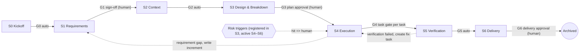

# FlowGate

[简体中文](./README.md) | English

[](https://github.com/ChthollyWn/dsh-flowgate/actions/workflows/ci.yml)
[](LICENSE)
[](docs/compat/0.2.1-rc.5.md)


> **One sentence:** FlowGate turns the specification layer of OpenSpec, the execution discipline of Superpowers, and the delivery loop of gstack into a DSH plugin's own capabilities, and enforces a 7-stage development pipeline in code — if the previous stage is not complete, the next stage's writes are rejected, with an explanation of what is missing and how to unlock.

- Host: DeepSeek Harness (DSH) `>=0.2.1-rc.5 <0.3.0` (Desktop / Web)
- Package: `dsh-flowgate`, MIT licensed
- Repository: <https://github.com/ChthollyWn/dsh-flowgate>
- Status: **v0.1 in development** (feature status table below; anything not done is marked as planned — see [docs/impl/implementation-status.md](docs/impl/implementation-status.md) for actual status and known gaps)

---

## Why this exists (three pieces of hard evidence)

1. **Prompts cannot enforce discipline.** The Superpowers v7.0.1 release notes state that, before the brainstorming rewrite, in one test scenario the agent **skipped the design document and started coding in 24 out of 24 runs**; after the rewrite it still happened 3 times. Discipline has to be enforced by code.
2. **DSH has no native stage gates.** The official [`dsh-plan-mode`](docs/reference/dsh-0.2.1-rc.5/dsh-plan-mode.zh.md) docs say: "it does not restrict the agent: every tool remains callable, so use sandbox mode and approval prompts when you need hard limits." Sandboxes and approvals govern "may I do this", not "should this be done now".
3. **Existing gate plugins leave a gap.** Competitive research found that current DSH gate plugins tend to be soft by default, produce false positives, silently fail, and can even prevent the host from starting; nobody implements the ordered state machine of "step 0 is not done, so step 3 is forbidden". FlowGate makes the ordering a hard constraint while treating false positives and graceful degradation as first-class concerns.

## What it looks like: a 7-stage pipeline



When starting from an empty repository, a project roadmap comes before S0: project-level clarification → split into capabilities → engineering skeleton C0 → owner approval (GR) → each change walks the pipeline above.

| Stage | Judgment to practice | Main artifacts | Exit gate | Who approves |
|---|---|---|---|---|
| Project roadmap / S0 kickoff | How to split capabilities, where the MVP line sits | `project-clarify.md`, `roadmap.md`, change directory | GR / G0 | Human / auto |
| S1 Requirements | Is the goal, boundary, and acceptance criteria verifiable? | `clarify.md`, `proposal.md`, delta spec | G1 | **Human** |
| S2 Context | Which facts does the agent need so it does not guess? | `context.md`, baseline test record | G2 | Auto |
| S3 Design & breakdown | Are tasks small enough to finish and verify one by one; are risks identified early? | `design.md`, `risk.md`, `tasks.md`, execution graph | G3 | **Human** |
| S4 Execution | Write the failing test first; only touch the declared files; stop after three failures and find the root cause | Code + RED/GREEN evidence per task | G4 (task gate) | Auto |
| S5 Verification | What evidence proves it works, and was it produced after the last change? | Full test suite vs baseline, review verdicts, runtime evidence | G5 | Auto |
| S6 Delivery | Can someone else take over, can it be rolled back, were lessons captured? | Commit notes, CHANGELOG, archived specs, retro, HTML report | G6 | **Human** |

Process level has two independent dimensions: **complexity** (low / medium / high / ultra) decides how much of the pipeline runs, and **risk** (normal / high) decides how strict the checks are. Low complexity needs only two human confirmations (plan confirmation card + delivery confirmation); a "small but dangerous" change can take the short path while still being checked strictly.

## Three hard constraints (code, not prompts)

- **Ordering:** in S0–S3 only stage artifacts may be written; source writes are rejected. In S4 you must claim a task first and may only write inside that task's declared scope.
- **Evidence:** verification is executed by the plugin (`flow_verify`), producing receipts with command, exit code, test counts, and input hashes. Receipts expire when inputs change. "It passed on my machine" does not count.
- **Delivery:** G1 / G3 / G6 are human gates. The agent has no tool to approve, override, or lower a level; pushes and PR creation can only happen after G6 and only when the owner triggers them.

## Quick start (isolated profile)

Do not install into your daily `desktop` profile before M6. Create an isolated development profile first:

```bash
# Use the CLI bundled with the desktop app (a global dsh may be outdated)
DSH="/Applications/DeepSeek Harness.app/Contents/Resources/runtime/cli/bin/dsh"

# 1. Create an isolated web profile (first time only; re-running overwrites that profile)
"$DSH" flowgate-dev --from-default-profile web

# 2. Install the plugin: link: during development, npm package name for releases
"$DSH" plugin --profile flowgate-dev add link:/path/to/dsh-flowgate
# after release: "$DSH" plugin --profile flowgate-dev add dsh-flowgate

# 3. Confirm the plugin line exists in the composition tree
"$DSH" --profile flowgate-dev --dump-config | grep -i flowgate

# 4. Start
"$DSH" --profile flowgate-dev
```

Then initialize the project to be governed and start the first change:

```text
/flow init                       # scan the repo, draft .flowgate/project.md (owner confirms)
/flow new add sharing to the todo list   # create a change, enter S1 requirements
...                              # agent reads code, asks structured questions, writes clarify/proposal/spec
/flow approve G1                 # you sign off the requirements
...                              # S2 context -> S3 design/risk/task cards; agent calls flow_submit
/flow approve G3                 # approve design, risks, and task list in one go
...                              # S4 execution (per execution graph); plugin verifies and reviews each task
/flow report                     # after S5, generate the HTML delivery report
/flow approve G6                 # delivery confirmation; plugin archives specs
```

> Projects that never ran `/flow init` are **not** gated; the status bar only suggests `/flow init` (FR-15.1).
>
> Host requirements: `engines.dsh >=0.2.1-rc.5 <0.3.0`; `@deepseek-ai/*` packages are peerDependencies only, so host core packages never enter the bundle.

## Commands (human-only; never sent to the model)

| Command | Purpose |
|---|---|
| `/flow` | Show state: stage, gate checks, active tasks, pending items, next step |
| `/flow init` | Scan the repo and draft `.flowgate/project.md` |
| `/flow new <description>` | Create a change; `/flow new --project <description>` declares a new project (project-level clarification + roadmap first) |
| `/flow approve <gate>` | Approve the current human gate (GR / G1 / G3 / G6; low complexity combines G1+G3 in one confirmation card) |
| `/flow reject <reason>` | Reject the current human gate; the reason is injected to the agent |
| `/flow roadmap` | Show the roadmap and each change's status |
| `/flow resume [change]` / `/flow pause` | Resume / pause a change (pause writes a handoff summary and releases the lease) |
| `/flow resume <change> --takeover` | Take over a change owned by another live session |
| `/flow handoff` | Generate a handoff summary immediately |
| `/flow board` | Open the cross-session `dashboard.html` board |
| `/flow parallel <n>` | Change the parallel limit (affects future batches only) |
| `/flow allow-once <rule id or last> <reason>` | One-time override (`OV-n`, applies to the next matching action only) |
| `/flow scope approve\|reject <SC-n> [reason]` | Handle scope-change requests |
| `/flow risk approve\|reject <RK-n> [reason]` | Handle risk take-over items |
| `/flow plan approve\|reject <PC-n> [reason]` | Handle plan-revision requests |
| `/flow rule approve\|reject <RL-n> [reason]` | Handle rule-sedimentation proposals |
| `/flow unblock [BL-n\|task id] [reason]` | Clear a consecutive-failure breaker (T-FAILURE-LIMIT): reset the failure count, resume the paused task, and close the task's remaining open `BL-*` blockers (no argument = the current change's single open blocker) |
| `/flow complexity <level> [reason]` / `/flow risk-level <level> [reason]` | Adjust levels; lowering requires a human reason |
| `/flow learn <detail\|brief\|off>` | Learning-mode verbosity |
| `/flow metrics [--csv]` | Show metrics (M-1..M-18) |
| `/flow report` | Generate and open the HTML delivery report |
| `/flow doctor` / `/flow repair` | Self-check / rebuild state from the ledger and artifacts |
| `/flow off` / `/flow on` | Turn gating off / on for this session (recorded; status bar turns red when off) |

## Model tools (no approve, override, or lower-level tools)

| Tool | When | Notes |
|---|---|---|
| `flow_status` | Anytime | Current stage, gate checks, active tasks, allowed next steps |
| `flow_new_change` | Before kickoff | Create a change or read-only analysis task (`kind: change \| analysis`); can start from a roadmap item |
| `flow_submit` | After finishing a stage's artifacts | Run gate checks (GR / G0 / G1 / G2 / G3 / G5 / G6); human gates wait for the owner |
| `flow_task_start` | S4 (`dispatch: inline`) | Claim a task card with relevant context, TDD requirements, verify commands; must follow the execution graph |
| `flow_dispatch_next` | S4 (dispatch mode) | Start the next batch per the graph; returns summaries, task gates, and checkpoint results |
| `flow_task_done` | S4 | Task gate: evidence freshness, scope, TDD, review |
| `flow_verify` | S2–S5 | Plugin-executed verification and receipt; only these receipts count as RED/GREEN evidence |
| `flow_request_scope_change` | S4 | Request a task scope extension (`SC-n`) |
| `flow_request_plan_change` | S4 | Request added tasks / reorder not-yet-started tasks (`PC-n`) |
| `flow_report_risk` | S3–S6 | Proactively report a risk (`RK-n`) |
| `flow_attach_evidence` | S4–S5 | Attach manual evidence (screenshots, logs); marked "agent claim", never a substitute for `flow_verify` |
| `flow_propose_rule` | S4–S6 | Propose a project rule for recurring findings (`RL-n`, owner approval required) |
| `flow_investigate` | Analysis tasks, S1–S2 | Spawn read-only investigation subagents (default max 2) returning cited reports |
| `flow_submit_analysis` | Analysis tasks | Submit conclusion, proposal, limitations, and source citations; the plugin verifies citations before archiving |
| `flow_diff` | Review subagents only | Read-only diff of the task under review |

## Rule reference

Rules are data (built-in defaults + `.flowgate/config.yaml` overrides), not hard-coded branches. Example defaults:

```yaml
# overridden or extended under `rules:` in .flowgate/config.yaml
- id: R-STAGE-SRC          # S0–S3 may not write source code
  when: { stage: [S0, S1, S2, S3], action: write, path: "**", except: [".flowgate/changes/{change}/**"] }
  decision: deny
  unlock: finish the stage artifacts and call flow_submit; for an urgent change ask the owner for /flow allow-once R-STAGE-SRC <reason>
- id: R-SCOPE              # S4 may only write inside the current task's scope
  when: { stage: [S4], action: [write, create, delete], outside: task.scope }
  decision: deny
  unlock: call flow_request_scope_change with the extra paths and reason, then wait for owner approval
- id: R-DEP                # dependency changes require a human
  when: { stage: [S4, S5], action: dependency }
  decision: human
```

**Evaluation order:** protected paths → locked mode → risk triggers (human) → stage policy → task scope → new-file control → TDD ordering → overrides/exceptions → allow by default. Once a rule denies, later rules cannot flip the decision; a one-time override only cancels the exact rule it names.

**Built-in risk triggers (tunable under `triggers`):** sensitive paths (auth / payment / migrations / infrastructure / CI / production config), dependency manifest changes, dangerous commands (`rm -rf`, `git push --force`, `git reset --hard`, `DROP`/`TRUNCATE`, `curl … | sh`, etc.), suspected secrets, budget overruns, scope inflation, consecutive failures. A hit rejects the current action and creates a pending item; the owner can approve a one-time pass. **The consecutive-failure breaker only blocks actions that would make progress or mutate state** (file writes, workspace-mutating commands, progress tools such as `flow_verify` / `flow_task_done`); `read`/`glob`/`grep`, read-only commands and `flow_status`/`flow_diff`/`flow_report_risk` stay allowed so the agent can gather evidence and find the root cause before the owner runs `/flow unblock <BL-n>`.

For the full rule definitions, command tokenization, and false-positive regression cases see [docs/03-技术方案.md](docs/03-技术方案.md) §4–§5.

## What is in the repo

```text
src/core/          pure logic: state machine, rules, artifact checks, ledger, evidence, metrics, reports (no @deepseek-ai/* imports)
src/host/          DSH host adapter: guards, commands, tools, presets, projection, review and dispatch
src/client/        React panel and input status bar (bundled for window.__ModuleLoader__)
skills/            15 built-in skills (SKILL.md + learn.md learning cards)
examples/          three benchmark repos: ts-todo-api, py-csv-cli, java-renewal
docs/              requirements, technical design, execution plan, implementation contracts, method sources, DSH references
```

### 15 built-in skills

| Stage | Skill | Upstream ideas it adapts (rewritten as built-in capabilities) |
|---|---|---|
| Starting from zero | `flow-roadmap` | gstack `/office-hours`, `/plan-ceo-review`; Superpowers brainstorming; OpenSpec "one capability per change" |
| S1 Requirements | `flow-clarify` | Superpowers brainstorming; gstack `/spec`; OpenSpec propose / explore |
| S2 Context | `flow-context` | OpenSpec `config.yaml` context / rules |
| S3 Design | `flow-design` | Superpowers multi-option comparison; gstack `/plan-eng-review` |
| S3 Plan | `flow-plan` | Superpowers writing-plans; OpenSpec tasks |
| S4 Scheduling | `flow-orchestrate` | Superpowers subagent-driven-development, dispatching-parallel-agents |
| S4 Execution | `flow-tdd`, `flow-debug`, `flow-scope` | Superpowers TDD / systematic-debugging; gstack `/freeze`, `/careful`, `/investigate` |
| S4–S5 Verification | `flow-verify`, `flow-review`, `flow-qa` | Superpowers verification-before-completion / code review; gstack `/review`, `/qa`, `/cso` |
| S6 Delivery | `flow-ship`, `flow-retro` | gstack `/ship`, `/document-release`, `/retro`; OpenSpec archive; Superpowers finishing-a-development-branch |
| Analysis tasks | `flow-analysis` | dsh-task-engine's read-only analysis contract; Superpowers "find the root cause first" |

Every skill ships a `SKILL.md` (when to use, executable steps, what code enforces, what is guidance only, anti-patterns, good/bad examples, artifact paths) and a `learn.md` learning card (what / why / acceptance criteria / upstream practice / anti-patterns / good / bad). Upstream versions and per-skill provenance are tracked in [docs/method-sources.md](docs/method-sources.md); third-party notices are in [THIRD_PARTY_NOTICES.md](THIRD_PARTY_NOTICES.md).

## Feature status (v0.1, checked 2026-10-31)

> Honest status: ✅ implemented with automated/offline verification; 🟡 implemented, pending real-host end-to-end confirmation; 🗓 planned. Evidence: [docs/impl/implementation-status.md](docs/impl/implementation-status.md).

| Capability | Status |
|---|---|
| 15 built-in skills (30 SKILL/learn files), method-source table, third-party notices | ✅ done |
| Three benchmark repos (TS / Java / Python, independently buildable/testable) | ✅ done and executed ([examples/](examples/README.md)) |
| State machine + level matrix, rules engine + shell tokenizer, scope control | ✅ done (core unit tests + engine integration tests) |
| Artifact parsers, 46 gate checks (GR/G0–G3/G5/G6), task cards, execution plan/graph | ✅ done (positive + negative per check) |
| `.flowgate/`, change ledger, hash-chained + HMAC audit ledger, cross-session leases, locked mode and `/flow repair` | ✅ done (tamper located by line; strict rebuild round-trip) |
| Verification receipts, input-hash freshness, risk engine, rework invalidation, verifiable citations | ✅ done |
| Review subagent, execution-graph dispatch, worktree parallelism, integration checkpoints | 🟡 wired + dedicated unit tests (slot refill, checkpoint repair/retry, `run: main` routing, line-level read coverage, same-diff dedupe, three final conclusions, checkpoint task verification + full tests); a real headless host verified worktree creation, executor subagents, task gates and review, and **sequential dispatch settled all the way to S5** (3 batches done, G4 passed); parallel batches really start but the one-shot run exits before the integration-checkpoint merge, so an interactive/long-lived host is still needed |
| Input-dock status bar, 8-view right sidebar panel, stage cards, learning modes | ✅ walked through in a real DSH web host: status bar, 8 views, in-session preset switch, panel-button Remote fallback, low-complexity confirmation card (25 screenshots; `13-`–`26-` added this round); intercept-view misjudgement feedback verified at component level |
| HTML delivery report, cross-session dashboard | ✅ done (single-file, offline, samples in test/fixtures) |
| Metrics M-1..M-18, export, rule capture, read-only analysis tasks | ✅ done (missing data is reported as "unknown", never 0) |
| With / without plugin evaluation report | ✅ **18/18 runs done + manual scoring of all 4 subjective metrics 18/18** (9 tasks × A/B, real model + headless); this round also adds the from-scratch and dispatch (inline vs auto) comparisons ([§6.5–§6.7](docs/evaluation.md)). Honest conclusion: B did not win on requirement coverage (most B runs were blocked by environment/human gates); its real gains are zero false completions and auditable process — small sample, not generalizable |

**Verification boundary**: `pnpm lint && pnpm test && pnpm build && pnpm verify:package && pnpm verify:client` are green (**107 files / 1459 tests**); `pnpm coverage` passes thresholds (80/80/80/70; core/host details in implementation-status §2; CI also runs coverage); a real DSH 0.2.1-rc.5 process composes and imports this plugin via `--dump-config`, and `verify:compat` reruns **13/13** in an isolated profile (6 offline structural checks included; `--dump-config-schema` also fails on rc.5 for the host's own preset rows, so it is not used as evidence — see [docs/compat/0.2.1-rc.5.md](docs/compat/0.2.1-rc.5.md)); real web-host UI and a real-model S0→S6 run have been exercised; the controlled evaluation has completed all 18 runs plus subjective scoring, with counterexamples/blockers and sandbox caveats in [docs/evaluation.md](docs/evaluation.md) and [docs/impl/implementation-status.md](docs/impl/implementation-status.md). The fifth-round acceptance-gap audit and the remaining items are in [acceptance-gap-audit](docs/impl/acceptance-gap-audit-2026-10-31.md).

## Screenshots

Taken in a real DSH `0.2.1-rc.5` web host (isolated `flowgate-dev` profile); how to reproduce: [docs/screenshots/](docs/screenshots/README.md).

| Input-dock status bar | Right-sidebar panel |
|---|---|
|  |  |

## FAQ

**Can it lock me out?**
No dead ends: `/flow allow-once`, "add exception" in the panel, `/flow off` (recorded and counted in metrics), `/flow doctor`, and `/flow repair` (rebuild state from the ledger and artifacts). During development use an isolated profile so the worst case is recreating that profile.

**What about false positives?**
There is a feedback loop: mark an interception as a false positive in the panel → allow once / add an exception (with a reason, revocable) / export evidence. The target is a false-positive rate (M-5) ≤ 5%; rules above that are downgraded to warnings and go into the retro (only after ≥ 20 intercepts; the downgrade allows that one action, logs `rule.hinted`, and enters the retro).

**What happens if I don't initialize?**
Nothing is gated. Gating is enabled only when `.flowgate/config.yaml` exists; the status bar merely suggests `/flow init`.

**My stack isn't auto-detected.**
Detection covers Maven, Gradle, npm / pnpm / yarn, pytest, Go, and Cargo. If detection fails, write commands in `.flowgate/project.md` or override them under `commands:` in `config.yaml`. If the project genuinely has no tests, set `test: none`; the baseline falls back to build / type-check / lint and a "missing automated tests" risk is recorded automatically.

**Does it upload my code?**
No. It does not use the network, upload anything, or collect telemetry; the ledger, reports, and dashboard all live under the local `.flowgate/`.

**Where is state stored, and does it go into git?**
Everything lives in the project-root `.flowgate/`. By default the whole directory is git-ignored (the plugin writes its own `.gitignore` inside it and never edits the project-root `.gitignore`); optionally `git.commit_flowgate: true` commits most files except `state/`, `worktrees/`, and `dashboard.html`. Deleting the directory or running `git clean -x` loses all records.

**How does this relate to DSH plan mode and approvals?**
`dsh-plan-mode` does not restrict tools, and approvals govern "may I execute". FlowGate governs "should this happen now". They are complementary; sandboxes and approvals still work inside a governed session, but gate decisions do not depend on them.

**What is the token cost?**
Runtime context injection is bounded at ≤ 600 tokens per step (≤ 1000 in detailed learning mode), and test output is compressed to ≤ 400 tokens by default. `/flow learn brief|off`, the low-complexity fast lane, and per-task context injection keep it down further. Process overhead (M-15) will be measured in the evaluation before tuning.

**Can it coexist with other plugins?**
Any plugin failure must not block host startup or affect other plugins; guard exceptions fail closed (that write is rejected with an explanation). In governed sessions native delegation tools are disabled so subagents can only be dispatched by FlowGate.

**Why not just use OpenSpec / Superpowers / gstack?**
Their methods are good, but they are prompt/workflow shaped and a model can bypass them. FlowGate adapts the methodology into host-level hard constraints while keeping OpenSpec's artifact format, so what you learn transfers back to the upstream tools.

## Development

```bash
pnpm install
pnpm lint        # layer lint + tsc --noEmit
pnpm test        # vitest
pnpm build       # tsdown
pnpm verify:package   # inspect the npm tarball (no host core packages; lib/ + skills/)
pnpm verify:client    # offline check of the browser bundle protocol + slot registrations
pnpm verify:compat    # compose/import the plugin in an isolated DSH_HOME (never the daily profile)
pnpm verify:uninstall # isolated-profile install/uninstall cleanliness (never the daily profile)
pnpm measure:startup  # host entry module-load overhead (T6.2, target <200ms)
```

During development use the isolated profile (see Quick start); do not install into the daily profile before M6. See [examples/README.md](examples/README.md) for how to run the three benchmark repos.

## Documentation

- [00-总览与阅读指南](docs/00-总览与阅读指南.md): one-page overview, pipeline, learning map
- [02-需求规格说明](docs/02-需求规格说明.md): functional requirements, acceptance scenarios, metrics, v1.0 definition of done
- [03-技术方案](docs/03-技术方案.md): DSH extension points, state machine, rule engine, data formats, UI
- [04-执行方案](docs/04-执行方案.md): milestones, task cards, risks and mitigations
- [docs/method-sources.md](docs/method-sources.md): per-skill upstream provenance, what we rewrote, review cycle
- [docs/reference/](docs/reference/): official package references for DSH 0.2.1-rc.5
- [docs/impl/implementation-status.md](docs/impl/implementation-status.md): per-milestone delivery status and known gaps
- [docs/evaluation.md](docs/evaluation.md): with/without-plugin evaluation (18/18 + subjective scoring) plus from-scratch and dispatch comparisons
- [docs/impl/web-walkthrough.md](docs/impl/web-walkthrough.md): real web-host interaction walkthrough (preset switching, panel fallbacks, confirmation card)
- [docs/screenshots/](docs/screenshots/): real web-host screenshots (25)
- [docs/interview-notes.md](docs/interview-notes.md): interview / portfolio notes (capability → mechanism → metric → real story)

## License

MIT, see [LICENSE](LICENSE). Method provenance and third-party notices are in [THIRD_PARTY_NOTICES.md](THIRD_PARTY_NOTICES.md).
