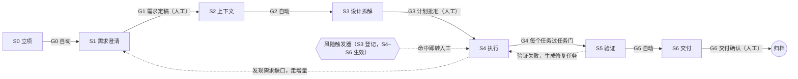
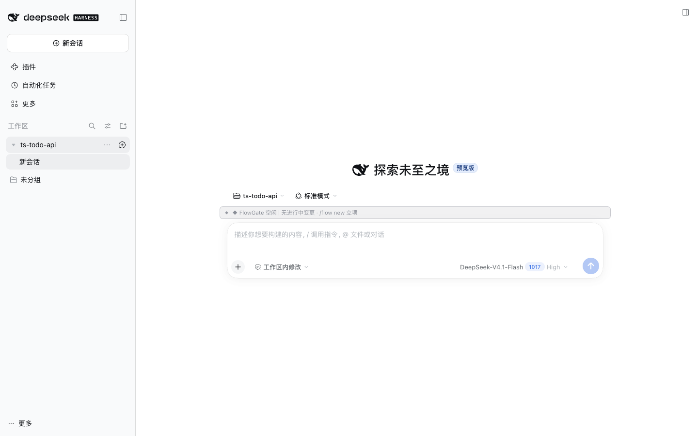
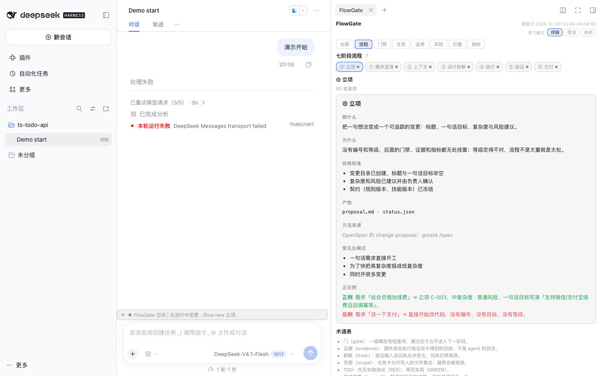

# FlowGate（流程门禁）

> **一句话：** 把 OpenSpec 的规格层、Superpowers 的执行纪律层、gstack 的交付闭环层改写成 DSH 插件自己的能力，用代码强制执行一条 7 阶段开发流水线——前一步没完成，后一步的写操作直接被拒绝，并告诉 agent 缺什么、怎么解锁。

[English](./README.en.md) | 简体中文

[](https://github.com/ChthollyWn/dsh-flowgate/actions/workflows/ci.yml)
[](LICENSE)
[](docs/compat/0.2.1-rc.5.md)


- 宿主：DeepSeek Harness（DSH）≥ `0.2.1-rc.5 < 0.3.0`（Desktop / Web）
- 包名：`dsh-flowgate`，MIT 许可
- 仓库：<https://github.com/ChthollyWn/dsh-flowgate>
- 状态：**v0.1 开发中**（功能状态见下文表格，未完成的明确标为规划中；实现状态与已知缺口见 [docs/impl/implementation-status.md](docs/impl/implementation-status.md)）

---

## 为什么值得做（三条硬证据）

1. **靠提示词约束不住。** Superpowers v7.0.1 官方发布说明：brainstorming 改版前的一个测试场景里，agent **24 次运行有 24 次跳过设计文档直接开工**；改版后仍有 3 次。纪律必须由代码执行。
2. **DSH 原生没有阶段门禁。** [`dsh-plan-mode`](docs/reference/dsh-0.2.1-rc.5/dsh-plan-mode.zh.md) 的官方说明写明："它不限制 agent：每个工具仍可调用，因此需要强制限制时请使用沙箱模式与审批提示。"沙箱和审批管的是"能不能做"，不管"现在该不该做"。
3. **现有 DSH 门禁类插件留出了空位。** 竞品调研结论：默认偏软、误伤多、会静默失效甚至让宿主起不来；没有人做"第 0 步没做就禁止第 3 步"的顺序状态机。FlowGate 把"顺序"做成硬约束，同时把误伤和降级路径当一等公民。

## 它长什么样：7 阶段流水线



从 0 开发时，S0 之前先做项目路线图：项目级澄清 → 按能力拆变更 → 工程骨架 C0 → 负责人批准（GR）→ 逐个变更走上面的流水线。

| 阶段 | 要练的判断 | 主要产物 | 出口门 | 谁放行 |
|---|---|---|---|---|
| 项目路线图 / S0 立项 | 怎样按能力拆变更、MVP 切线放哪 | `project-clarify.md`、`roadmap.md`、变更目录 | GR / G0 | 人工 / 自动 |
| S1 需求澄清 | 目标、边界、验收标准是否"可被验证" | `clarify.md`、`proposal.md`、增量规格 | G1 | **人工** |
| S2 上下文 | agent 需要哪些事实才不用猜 | `context.md`、基线测试记录 | G2 | 自动 |
| S3 设计拆解 | 任务是否小到能独立完成、能逐个验收；风险是否提前识别 | `design.md`、`risk.md`、`tasks.md`、执行流程图 | G3 | **人工** |
| S4 执行 | 先写失败的测试；只改该改的文件；失败三次就停下来查根因 | 代码 + 每个任务的 RED/GREEN 证据 | G4（任务门） | 自动 |
| S5 验证 | 什么证据才能证明"真的可用"、证据是否在最后一次改动之后 | 全量测试与基线对比、审查结论、运行证据 | G5 | 自动 |
| S6 交付 | 交付物能不能让别人接手、能不能回滚、坑有没有沉淀 | 提交说明、CHANGELOG、归档规格、复盘、HTML 报告 | G6 | **人工** |

流程等级分两个维度：**复杂度**（低 / 中 / 高 / 超高）决定流程走多完整，**风险**（普通 / 高）决定检查有多严。低复杂度只做 2 次人工确认（方案确认卡 + 交付确认）；"小而危险"的改动可以走短流程、同时受严格检查。

## 三个硬约束（不是提示词，是代码）

- **顺序约束：** S0–S3 只能写本阶段产物，写源码一律拒绝；S4 必须先领取任务，且只能写当前任务卡声明的范围。
- **证据约束：** 验证由插件执行（`flow_verify`），产生带命令、退出码、用例数、输入哈希的回执；回执会因输入变化而过期。"我本地跑过了"不认。
- **交付约束：** G1 / G3 / G6 是人工门，agent 没有批准、放行、降低等级的工具；推送和创建 PR 只能在 G6 之后由负责人触发。

## 快速开始（隔离 profile）

M6 之前不要在日用 `desktop` profile 里安装，先建一个隔离的开发 profile：

```bash
# 用桌面端自带 CLI（全局 dsh 可能是旧版，不要用）
DSH="/Applications/DeepSeek Harness.app/Contents/Resources/runtime/cli/bin/dsh"

# 1. 从官方 web 模板建一个隔离 profile（只在第一次执行；重复执行会覆盖该 profile）
"$DSH" flowgate-dev --from-default-profile web

# 2. 安装插件：开发中用 link:，正式用 npm 包名
"$DSH" plugin --profile flowgate-dev add link:/path/to/dsh-flowgate
# 发布后也可以： "$DSH" plugin --profile flowgate-dev add dsh-flowgate

# 3. 确认组合树里有 FlowGate 的插件行
"$DSH" --profile flowgate-dev --dump-config | grep -i flowgate

# 4. 启动
"$DSH" --profile flowgate-dev
```

在要被管控的项目里初始化，然后开始第一个变更：

```text
/flow init                       # 扫描仓库，生成 .flowgate/project.md 草稿（负责人确认）
/flow new 给待办列表加分享功能      # 立项，进入 S1 需求澄清
...                              # agent 读代码、结构化提问、产出 clarify/proposal/spec
/flow approve G1                 # 你定稿需求
...                              # S2 上下文 → S3 设计/风险/任务卡，agent 调用 flow_submit
/flow approve G3                 # 你一次批准设计、风险和任务清单
...                              # S4 执行（按执行图）；每个任务由插件验证并审查
/flow report                     # S5 通过后生成 HTML 交付报告
/flow approve G6                 # 交付确认；插件归档规格
```

> 没执行过 `/flow init` 的项目**不会**被拦截，状态条只提示可以用 `/flow init` 启用（FR-15.1）。
>
> 插件对 DSH 的要求：`engines.dsh >=0.2.1-rc.5 <0.3.0`；`@deepseek-ai/*` 只作 peerDependencies，不把宿主核心包打进依赖树。

## 命令表（人工专属，不会进入模型消息）

| 命令 | 作用 |
|---|---|
| `/flow` | 展开当前状态：阶段、门禁检查项、活动任务、待处理项、下一步 |
| `/flow init` | 扫描仓库，生成 `.flowgate/project.md` 草稿 |
| `/flow new <描述>` | 立项；`/flow new --project <描述>` 声明新项目（先做项目级澄清和路线图） |
| `/flow approve <门>` | 批准当前人工门（GR / G1 / G3 / G6；低复杂度时方案确认卡一次批准 G1+G3） |
| `/flow reject <意见>` | 退回当前人工门，意见注入给 agent |
| `/flow roadmap` | 查看路线图与每个变更的状态 |
| `/flow resume [变更]` / `/flow pause` | 继续 / 暂停变更（暂停会写交接摘要、释放租约） |
| `/flow resume <变更> --takeover` | 接管正被其他会话占用的变更 |
| `/flow handoff` | 立即生成交接摘要，准备开新会话 |
| `/flow board` | 打开跨会话看板 `dashboard.html` |
| `/flow parallel <数量>` | 调整并行上限（只影响之后启动的批次） |
| `/flow allow-once <规则 id 或 last> <理由>` | 单次放行（`OV-n`，只放行下一次匹配的动作） |
| `/flow scope approve\|reject <SC-n> [理由]` | 处理范围变更申请 |
| `/flow risk approve\|reject <RK-n> [理由]` | 处理风险接管项 |
| `/flow plan approve\|reject <PC-n> [理由]` | 处理计划修订申请 |
| `/flow rule approve\|reject <RL-n> [理由]` | 处理规则沉淀提议 |
| `/flow complexity <级别> [理由]` / `/flow risk-level <级别> [理由]` | 调整流程等级；降低必须由人执行并写理由 |
| `/flow learn <detail\|brief\|off>` | 学习模式详细度 |
| `/flow metrics [--csv]` | 查看指标（M-1～M-18） |
| `/flow report` | 生成并打开 HTML 交付报告 |
| `/flow doctor` / `/flow repair` | 自检 / 从账本和产物重建状态 |
| `/flow off` / `/flow on` | 本会话关闭 / 恢复门禁（记账；关闭时状态条变红） |

## 模型工具（没有批准、放行、降低等级类工具）

| 工具 | 何时用 | 关键说明 |
|---|---|---|
| `flow_status` | 任何时候 | 当前阶段、门禁检查项、活动任务、允许的下一步 |
| `flow_new_change` | 未立项时 | 创建变更或只读分析任务（`kind: change \| analysis`），可从路线图条目立项 |
| `flow_submit` | 完成某阶段产物后 | 提交门禁检查（GR / G0 / G1 / G2 / G3 / G5 / G6）；人工门通过后等待负责人 |
| `flow_task_start` | S4（`dispatch: inline`） | 领取任务卡、注入的上下文片段、TDD 要求、验证命令；必须按执行图顺序 |
| `flow_dispatch_next` | S4（派发模式） | 按执行图启动下一批任务；全部结束后返回摘要、任务门和集成检查点结果 |
| `flow_task_done` | S4 | 任务门：证据新鲜度、范围、TDD、审查 |
| `flow_verify` | S2–S5 | 由插件执行验证并记录回执；只有它的回执算 RED/GREEN 证据 |
| `flow_request_scope_change` | S4 | 申请扩大任务范围（`SC-n`） |
| `flow_request_plan_change` | S4 | 申请追加任务 / 调整未开始任务的顺序（`PC-n`） |
| `flow_report_risk` | S3–S6 | 主动上报风险（`RK-n`） |
| `flow_attach_evidence` | S4–S5 | 附手工证据（截图、日志），标为"agent 自述"，不能代替 `flow_verify` |
| `flow_propose_rule` | S4–S6 | 把重复出现的问题提议为项目规则（`RL-n`，需负责人批准） |
| `flow_investigate` | 分析任务、S1–S2 | 派只读调查子 agent（默认最多 2 个同时运行），回传带引用的报告 |
| `flow_submit_analysis` | 分析任务 | 提交结论、建议、限制与源码引用；插件核验引用后归档 |
| `flow_diff` | 审查子 agent 专用 | 只读取当前任务的 diff |

## 规则参考

规则是数据（内置默认 + `.flowgate/config.yaml` 覆盖），不是硬编码在代码里的分支。默认规则示例：

```yaml
# .flowgate/config.yaml 的 rules 下可覆盖或追加
- id: R-STAGE-SRC          # S0–S3 不能写源码
  when: { stage: [S0, S1, S2, S3], action: write, path: "**", except: [".flowgate/changes/{change}/**"] }
  decision: deny
  unlock: 完成当前阶段产物并 flow_submit；确需立即修改，请负责人 /flow allow-once R-STAGE-SRC <理由>
- id: R-SCOPE              # S4 只能写当前任务范围
  when: { stage: [S4], action: [write, create, delete], outside: task.scope }
  decision: deny
  unlock: flow_request_scope_change 说明要加的路径和理由，等负责人批准
- id: R-DEP                # 依赖变更转人工
  when: { stage: [S4, S5], action: dependency }
  decision: human
```

**判定顺序：** 受保护路径 → 锁定模式 → 风险触发器（转人工）→ 阶段策略 → 任务范围 → 新文件控制 → TDD 顺序 → 例外与单次放行 → 默认允许。前面的规则一旦拒绝，后面不再翻转；单次放行只抵消指定的那条规则。

**内置风险触发器（可在 `config.yaml` 的 `triggers` 调整）：** 敏感路径（鉴权 / 支付 / 迁移 / 基础设施 / CI / 生产配置）、依赖清单变更、危险命令（`rm -rf`、`git push --force`、`git reset --hard`、`DROP`/`TRUNCATE`、`curl … | sh` 等）、写入疑似密钥、成本超预算、范围膨胀、连续失败。命中即拒绝当前动作并生成待处理项，负责人批准后单次放行。

规则的完整定义、命令分词与误伤回归用例见 [docs/03-技术方案.md](docs/03-技术方案.md) §4–§5。

## 仓库里有什么

```text
src/core/          纯逻辑：状态机、规则、产物检查、账本、证据、指标、报告（不引用 @deepseek-ai/*）
src/host/          DSH 宿主适配：守卫、命令、工具、preset、投影、审查与派发
src/client/        React 面板与输入框状态条（window.__ModuleLoader__ 打包）
skills/            15 个内置技能（SKILL.md + learn.md 教学卡）
examples/          三个基准仓库：ts-todo-api、py-csv-cli、java-renewal
docs/             需求、技术方案、执行方案、实现契约、方法来源追踪表、DSH 参考
```

### 15 个内置技能

| 阶段 | 技能 | 借鉴的上游方法（均改写为自带能力） |
|---|---|---|
| 从 0 开发 | `flow-roadmap` | gstack `/office-hours`、`/plan-ceo-review`；Superpowers brainstorming；OpenSpec"一个能力一个 change" |
| S1 需求澄清 | `flow-clarify` | Superpowers brainstorming；gstack `/spec`；OpenSpec propose / explore |
| S2 上下文 | `flow-context` | OpenSpec `config.yaml` 的 context / rules |
| S3 设计 | `flow-design` | Superpowers 多方案对比；gstack `/plan-eng-review` |
| S3 计划 | `flow-plan` | Superpowers writing-plans；OpenSpec tasks |
| S4 调度 | `flow-orchestrate` | Superpowers subagent-driven-development、dispatching-parallel-agents |
| S4 执行 | `flow-tdd`、`flow-debug`、`flow-scope` | Superpowers TDD / systematic-debugging；gstack `/freeze`、`/careful`、`/investigate` |
| S4–S5 验证 | `flow-verify`、`flow-review`、`flow-qa` | Superpowers verification-before-completion / code review；gstack `/review`、`/qa`、`/cso` |
| S6 交付 | `flow-ship`、`flow-retro` | gstack `/ship`、`/document-release`、`/retro`；OpenSpec archive；Superpowers finishing-a-development-branch |
| 分析任务 | `flow-analysis` | dsh-task-engine 的只读分析契约；Superpowers "先找根因" |

每个技能都有 `SKILL.md`（何时用、可执行步骤、代码强制的部分、只做引导的部分、常见反模式、正反例、产物路径）和 `learn.md`（学习卡：做什么 / 为什么 / 合格标准 / 对应上游做法 / 常见反模式 / 正反例）。上游版本与逐条来源见 [docs/method-sources.md](docs/method-sources.md)，第三方声明见 [THIRD_PARTY_NOTICES.md](THIRD_PARTY_NOTICES.md)。

## 功能状态（v0.1，2026-10-31 复核）

> 如实标注：✅ = 已实现且有自动化测试/离线验证；🟡 = 已实现、待真实宿主端到端确认；🗓 = 规划中。验证证据见 [docs/impl/implementation-status.md](docs/impl/implementation-status.md)。

| 能力 | 状态 |
|---|---|
| 15 个内置技能（30 个 SKILL/learn 文件）、方法来源表、第三方声明 | ✅ 已实现 |
| 三个基准仓库（TS / Java / Python，可独立构建与测试，含隐藏需求与诱饵） | ✅ 已实现并实跑（[examples/](examples/README.md)） |
| 状态机与等级矩阵、规则引擎与命令分词、范围控制（事前 + shell 事后检测） | ✅ 已实现（core 单测 + 引擎集成测试） |
| 产物解析与 GR/G0/G1/G2/G3/G5/G6 检查（46 项）、任务卡检查、执行计划与执行图 | ✅ 已实现（每项检查一正一反） |
| `.flowgate/` 目录、台账、账本哈希链 + HMAC、跨会话接续与租约、锁定模式与 `/flow repair` | ✅ 已实现（篡改可定位第 N 行；重建可严格往返） |
| 证据回执、输入哈希判定过期、风险引擎、返工失效范围、可核验源码引用 | ✅ 已实现 |
| 审查子 agent、按执行图派发、worktree 并行、集成检查点 | 🟡 host 侧已接线 + 25 例专项单测；审查子 agent 已在真实 headless 宿主跑通（RV-2：覆盖核查通过 + 5 条 findings）；派发/worktree 结算待交互式会话 |
| 输入框状态条、右侧栏 8 视图面板、阶段卡、学习模式 | ✅ 已在真实 DSH Web 宿主渲染验证（11 张截图）；剩余：面板按钮 Remote 兜底、低复杂度确认卡 |
| HTML 交付报告、跨会话看板 | ✅ 已实现（单文件离线可用，样例见 test/fixtures） |
| 指标 M-1～M-18 自动计算与导出、规则沉淀、只读分析任务 | ✅ 已实现（取不到的数据标"未知"，不用 0 代替） |
| 有 / 无插件对照评测报告 | 🟡 pilot 1/9 完成（`ts-todo-api/fix-bug` A/B 各 1 次，两种条件均修复正确；B 组多 2 轮/13x 耗时/3 次人工门）；其余 8 任务与从 0 演练待跑，见 [docs/evaluation.md](docs/evaluation.md) §6.1 |

**验证边界**：`pnpm lint && pnpm test && pnpm build && pnpm verify:package && pnpm verify:client` 全绿（66 文件 / 972 用例）；真实 DSH 0.2.1-rc.5 下 `--dump-config` / `--dump-config-schema` 已加载本插件（[docs/compat/0.2.1-rc.5.md](docs/compat/0.2.1-rc.5.md)）；真实 web 宿主界面与真模型 S0→S6 已走查；有/无插件对照评测已完成 pilot（1/9 任务，A/B 各 1 次），完整 9×2 待跑，见 [docs/evaluation.md](docs/evaluation.md) 与 [docs/impl/implementation-status.md](docs/impl/implementation-status.md)。

## 界面

在真实 DSH `0.2.1-rc.5` Web 宿主（隔离 `flowgate-dev` profile）里的实拍，采集方式见 [docs/screenshots/](docs/screenshots/README.md)：

| 输入框状态条 | 右侧栏面板 |
|---|---|
|  |  |

## FAQ

**会不会把我锁死？**
不会只有一条路：`/flow allow-once` 单次放行、面板"加入例外"、`/flow off` 临时关闭（记账并计入指标）、`/flow doctor` 自检、`/flow repair` 从账本和产物重建。开发期用隔离 profile，最坏情况重建 profile。

**误伤怎么办？**
误判反馈闭环：在面板标"误判" → 放行本次 / 加入例外（写理由，可撤销）/ 导出证据。指标 M-5 误判率目标 ≤ 5%，超过 5% 的规则自动降为提示并进入复盘。

**不初始化会怎样？**
没有任何拦截。只有项目里存在 `.flowgate/config.yaml` 才启用；状态条只提示可以用 `/flow init`。

**要是我用的技术栈探测不到？**
探测支持 Maven、Gradle、npm / pnpm / yarn、pytest、Go、Cargo；探测不到时在 `.flowgate/project.md` 里手动写命令，或在 `config.yaml` 的 `commands:` 覆盖。项目确实没有测试时写 `test: none`，基线改用构建 / 类型检查 / lint，并自动登记"缺少自动化测试"风险。

**会不会上传我的代码？**
不会。不联网、不上传、不收集遥测；账本、报告、看板全部在本地 `.flowgate/`。

**数据存在哪，会进 git 吗？**
全部在项目根 `.flowgate/`。默认整个目录不进 git（插件在目录内生成 `.gitignore`，不改项目根 `.gitignore`）；可选 `git.commit_flowgate: true` 让部分文件随代码提交。删除该目录或 `git clean -x` 会丢失全部记录。

**和 DSH 的 plan mode / 审批是什么关系？**
`dsh-plan-mode` 不限制工具，审批管"能不能执行"，FlowGate 管"现在该不该做"。两者互补；FlowGate 的受控会话里仍可以用沙箱和审批，但门禁判定不依赖它们。

**token 开销大吗？**
运行时注入每步 ≤ 600 token（详细学习模式 ≤ 1000），测试输出压缩后默认 ≤ 400 token；支持 `/flow learn brief|off`、低复杂度快车道、按任务注入上下文。流程开销 M-15 会在评测中量化后再调。

**能和其他插件共存吗？**
插件任何故障不阻塞宿主启动、不影响其他插件；守卫内部异常时 fail-closed 拒绝该次写操作并提示。受管控会话里关闭原生委派工具，子 agent 只能由 FlowGate 派发。

**为什么不用现成的 OpenSpec / Superpowers / gstack？**
它们的方法很好，但都是提示词/工作流形态，模型可以绕过。FlowGate 借鉴方法论、用 DSH 插件把它变成宿主层的硬约束，同时沿用 OpenSpec 的产物格式，方便你学到的经验迁移回上游工具。

## 开发

```bash
git clone https://github.com/ChthollyWn/dsh-flowgate.git
cd dsh-flowgate
pnpm install
pnpm lint        # 分层 lint + tsc --noEmit
pnpm test        # vitest（含 core / host / client / 集成测试）
pnpm coverage    # 覆盖率（核心逻辑）
pnpm build       # tsdown
pnpm verify:package   # 检查 npm 包内容（不含宿主核心包，含 lib/ 与 skills/）
pnpm verify:client    # 离线验证浏览器 bundle 的加载协议与插槽注册
pnpm verify:compat    # 在隔离 DSH_HOME 里真实组合/导入插件（不碰日常 profile）
```

开发期请用隔离 profile（见"快速开始"）；M6 之前不要在日用 profile 里安装插件。三个基准仓库的跑法见 [examples/README.md](examples/README.md)。

## 文档

- [00-总览与阅读指南](docs/00-总览与阅读指南.md)：一句话定位、流水线、学习对照表
- [02-需求规格说明](docs/02-需求规格说明.md)：功能需求、验收场景、指标、v1.0 完成定义
- [03-技术方案](docs/03-技术方案.md)：DSH 扩展点、状态机、规则引擎、数据格式、界面
- [04-执行方案](docs/04-执行方案.md)：里程碑、任务卡、风险与对策
- [docs/method-sources.md](docs/method-sources.md)：每个技能的上游来源、改写了什么、复查周期
- [docs/spike-report.md](docs/spike-report.md)：M0 探针报告（H1–H26 实测结论）
- [docs/impl/dsh-plugin-api-cheatsheet.md](docs/impl/dsh-plugin-api-cheatsheet.md)：DSH 扩展点速查表（含 d.ts 出处）
- [docs/impl/host-integration.md](docs/impl/host-integration.md)：宿主集成与验证步骤
- [docs/impl/implementation-status.md](docs/impl/implementation-status.md)：里程碑交付状态与已知缺口
- [docs/compat/](docs/compat/)：DSH 版本兼容验证记录
- [docs/reference/](docs/reference/)：本机 DSH 0.2.1-rc.5 的官方包参考

## 许可

MIT，见 [LICENSE](LICENSE)。方法来源与第三方声明见 [THIRD_PARTY_NOTICES.md](THIRD_PARTY_NOTICES.md)。
