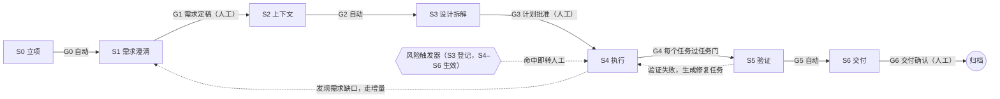

# FlowGate（流程门禁）：DSH 硬约束开发流程插件 —— 总览与阅读指南

> 历史方案快照（2026-10-30 定稿）。当前实现状态、已知缺口与验证证据见 [implementation-status.md](impl/implementation-status.md) 与 [release/v0.1.0.md](release/v0.1.0.md)。

> - 工作名：**FlowGate**，npm 包名 `dsh-flowgate`（2026-10-30 核对未被占用；`dsh-sop` 已被占用）。
> - 宿主：DeepSeek Harness（DSH）Desktop / Web，版本基线 `0.2.1-rc.5`（本机已安装的版本）。
> - 文档日期：2026-10-30。状态：需求已按你的回答定型，等你确认 `01` 里的假设后启动 M0。

---

## 一句话

把 OpenSpec 的规格层（做什么）、Superpowers 的执行纪律层（怎么做）、gstack 的交付闭环层（怎么交付）**改写成插件自己的能力**，由 DSH 宿主层代码强制执行一条 7 阶段流水线：前一步没完成，后一步的写操作直接被拒绝，并告诉 agent 缺什么、怎么解锁。整条流水线在侧栏可视化，每一步都讲清"在做什么、为什么、合格标准是什么"，全程自动产出可量化的指标。

## 为什么值得做（三条硬证据）

1. **靠提示词约束不住。** Superpowers 官方 v7.0.1 发布说明：brainstorming 改版前，在一个测试场景里 agent **24 次运行有 24 次跳过设计文档直接开工**，改版后仍有 3 次。纪律必须由代码执行。
2. **DSH 原生没有阶段门禁。** `dsh-plan-mode` 的官方说明写明："它不限制 agent：每个工具仍可调用，因此需要强制限制时请使用沙箱模式与审批提示。"沙箱和审批管的是"能不能做"，不管"现在该不该做"。
3. **现有插件留出了空位。** 你昨晚的竞品调研（`../../agent-project-direction/竞品反馈与功能期待.md`）结论：现有 DSH 门禁类插件默认偏软、误伤多、会静默失效甚至让宿主起不来；"第 0 步没做就禁止第 3 步"的顺序状态机没人做。

## 流水线总览

| 阶段 | 对应你列的能力 | 主要产物 | 出口门 | 谁放行 | 方法来源（已改写为内置能力） |
|---|---|---|---|---|---|
| S0 立项 | — | 变更目录、复杂度和风险建议、契约冻结 | G0 | 自动 | OpenSpec 的 change |
| S1 需求澄清 | 需求理解 | `clarify.md`、`proposal.md`、增量规格 | G1 需求定稿 | **人工** | Superpowers brainstorming；gstack `/office-hours`、`/spec`；OpenSpec propose / explore |
| S2 上下文 | 上下文组织 | `context.md`、基线测试记录 | G2 | 自动 | OpenSpec `config.yaml` 的 context / rules |
| S3 设计拆解 | 任务拆解 + 工程判断 | `design.md`、`risk.md`、`tasks.md`、执行流程图 | G3 计划批准 | **人工** | Superpowers writing-plans；gstack `/plan-eng-review`；OpenSpec design / tasks |
| S4 执行 | 过程控制 | 代码 + 每个任务的证据（按执行图顺序或并行派发子 agent） | G4 | 自动 | Superpowers TDD、subagent-driven-development、dispatching-parallel-agents、systematic-debugging；gstack `/freeze`、`/careful` |
| S5 验证 | 验证能力 | 全量测试与基线对比、审查结论、运行证据 | G5 | 自动 | Superpowers verification-before-completion、requesting-code-review；gstack `/review`、`/qa`、`/cso` |
| S6 交付 | 交付闭环 | 提交说明、CHANGELOG、归档后的主规格、复盘、HTML 报告 | G6 交付确认 | **人工** | gstack `/ship`、`/document-release`、`/retro`；OpenSpec archive |

"工程判断"贯穿 S3–S6：S3 写风险登记；S4–S6 由风险触发器在命中（依赖变更、敏感路径、危险命令、密钥、超预算、连续失败等）时强制转人工。

从 0 开发时，S0 之前还有一步"项目路线图"：先做项目级澄清，按能力拆成若干变更，由你批准（GR）之后，再让每个变更依次走上面这条流水线。

## 文档清单

| 文件 | 内容 | 什么时候读 |
|---|---|---|
| [01-需求澄清记录.md](01-需求澄清记录.md) | 你的原始描述、我先挖到的事实、8 个问题和你的回答、推导出的决定、默认假设与未决问题、两次追问的结论 | **先读**，确认我没理解错 |
| [02-需求规格说明.md](02-需求规格说明.md) | 目标与非目标、角色与场景、阶段与流程等级（复杂度 × 风险）、功能需求（带验收场景）、非功能需求、指标体系、v1.0 完成定义 | 确认"做什么" |
| [03-技术方案.md](03-技术方案.md) | DSH 扩展点映射、状态机与门禁、规则引擎、范围控制、证据与 TDD、审查、风险引擎、数据格式、对模型的工具、界面与学习模式、打包与兼容、失败降级 | 开工前 |
| [04-执行方案.md](04-执行方案.md) | 7 个里程碑、任务卡（范围 / 验收 / 验证命令）、日历、自举计划、评测方案、风险与对策、求职材料 | 开工时逐条执行 |
| [reference/dsh-0.2.1-rc.5/](reference/dsh-0.2.1-rc.5/) | 从本机 DSH 安装包导出的 28 份官方包 README（工具流水线、审批、提问、命令、会话、投影、技能、工作流、子 agent、侧栏、清单与兼容等） | 实现时查接口 |

## 学习对照：每一步要练什么判断、该读什么

你的首要目的之一是"详细学习标准化流程"。下面这张表也是插件里"阶段卡"学习内容的提纲。

| 阶段 | 要练的判断 | 典型反模式 | 推荐阅读（上游原文） |
|---|---|---|---|
| 项目路线图（从 0 开发） | 怎样按能力拆变更、MVP 切线放在哪、为什么第一个变更是工程骨架 | 一个变更包办整个项目；还没有测试框架就开始写业务 | gstack `/office-hours`、`/plan-ceo-review`；OpenSpec "一个能力一个 change"的组织方式 |
| S1 需求澄清 | 目标、边界、角色、验收标准是否都写到了"能被验证"的程度 | 拿到题就开写；验收标准写成"体验良好""尽快" | Superpowers `skills/brainstorming`；gstack `/office-hours`、`/spec`；OpenSpec [docs/opsx.md](https://github.com/fission-ai/openspec/blob/main/docs/opsx.md) 的 propose / explore |
| S2 上下文 | agent 需要哪些事实才不用猜：技术栈、接口、数据模型、约定、禁区、可复用模块 | 让 agent 自己"看着办"；不告诉它哪些地方不能碰 | OpenSpec `openspec/config.yaml` 的 `context` / `rules` |
| S3 设计拆解 | 任务是否小到能独立完成、能逐个验收；风险有没有提前识别；有没有回滚方案；哪些任务必须顺序、哪些可以并行 | 一个任务改十几个文件；方案只有一个且没有对比；明明要改同一个文件却安排并行 | Superpowers `skills/writing-plans`；gstack `/plan-eng-review`、`/autoplan` |
| S4 执行 | 先写失败的测试；只改该改的文件；失败三次就停下来查根因 | 顺手重构、重复造轮子、先写实现再补测试、反复试错 | Superpowers `skills/test-driven-development`、`skills/systematic-debugging`、`skills/subagent-driven-development`、`skills/dispatching-parallel-agents`；gstack `/freeze`、`/careful`、`/investigate` |
| S5 验证 | 什么证据才能证明"真的可用"；证据是不是在最后一次改动之后产生的 | "应该能跑"；拿旧的测试结果说事；只测成功路径 | Superpowers `skills/verification-before-completion`、`skills/requesting-code-review`；gstack `/review`、`/qa`、`/cso` |
| S6 交付 | 交付物能不能让别人接手、能不能回滚、这次的坑有没有沉淀 | 合并完就结束；不更新文档；不复盘 | gstack `/ship`、`/document-release`、`/retro`；OpenSpec archive |

上游仓库：[OpenSpec](https://github.com/Fission-AI/OpenSpec)（v1.15.0，2026-10-24）、[Superpowers](https://github.com/obra/superpowers)（v7.0.1，2026-10-21）、[gstack](https://github.com/garrytan/gstack)（MIT）。

## 已和你确认的关键决定

- 个人使用：你同时是需求方、开发者和验收人（下文统称"负责人"）。
- 默认拦截。流程等级分两个维度：复杂度（低 / 中 / 高 / 超大）决定流程走多完整，风险（普通 / 高）决定检查有多严，所以"小而危险"的改动可以走短流程、同时受严格检查。人可以单次放行，必须写理由并留痕；复杂度和风险只能由人调低。
- 人工放行只在 3 个节点：需求定稿（G1）、计划批准（G3）、交付确认（G6）；另外风险触发器命中时临时转人工。
- 三个上游全部改写为插件自己的能力，不依赖它们的 CLI 或技能包；产物格式沿用 OpenSpec 的约定，方便你把学到的东西迁移出去。
- 可视化三种形态：输入框上方的状态条、右侧栏面板、HTML 交付报告。
- 技术栈自动探测，用户可覆盖。
- 低复杂度走快车道：方案确认卡（G1 与 G3 合并）加交付确认，一共 2 次确认。
- 从 0 开发先做项目级澄清和路线图（GR，人工）；第一个变更固定是工程骨架，之后按能力逐个变更推进。
- 拆解时产出执行流程图，标明哪些任务必须顺序、哪些可以并行；执行阶段主会话按图派发子 agent：顺序批次逐个执行，并行批次同时执行（默认最多 3 个，各自在独立的 worktree 里），批次结束由插件合并并跑集成检查点。
- 插件的全部文件集中在项目里的 `.flowgate/` 目录（需求、任务、执行图、进行状态、变更台账等），默认整个目录不进 git；任何会话都能接着上次的进度继续，面板的台账视图和离线看板 `dashboard.html` 展示全部变更。
- 只在执行过 `/flow init` 的项目生效；受管控的会话使用 FlowGate 工程模式，关闭 DSH 原生的委派工具，子 agent 一律由插件按任务卡派发。
- 测试和构建由插件按任务卡声明的命令执行并记录回执（`flow_verify`），agent 自己跑的结果只作参考；回执按输入范围判断是否过期，返工只让受影响的任务失效。
- 写进需求和上下文的项目事实要带可核验的源码引用；只需要查清楚、不需要改代码的问题走只读分析任务，结论可以转成后续变更。
- 执行中可以申请修订计划；审查中发现、以后还会出现的问题，经你批准后沉淀为项目规则；取不到的指标数据标"未知"，不用 0 代替。
- 做完整版：按每周 4 个有效工作日计约 10.5 周；第 6 周先形成"可以自用的最小版本"。
