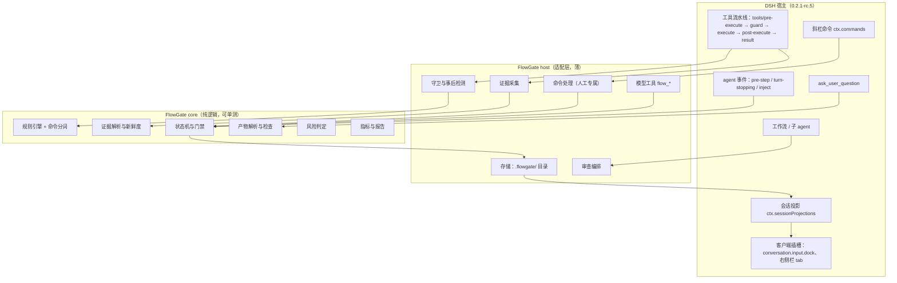
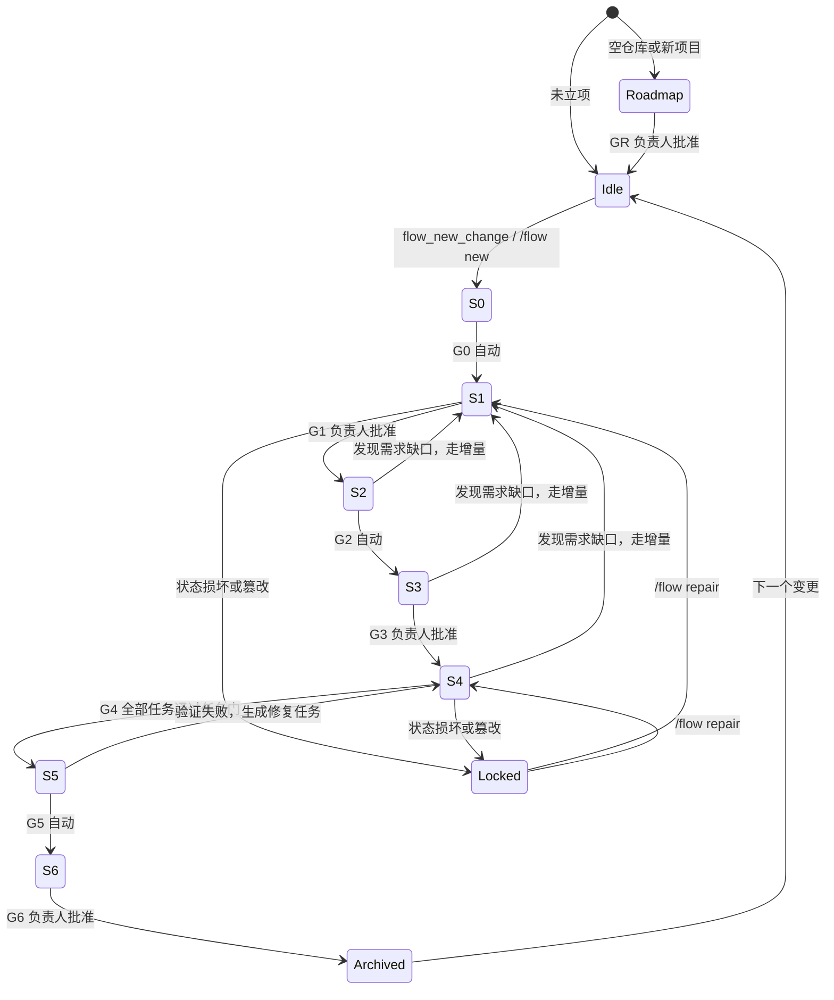
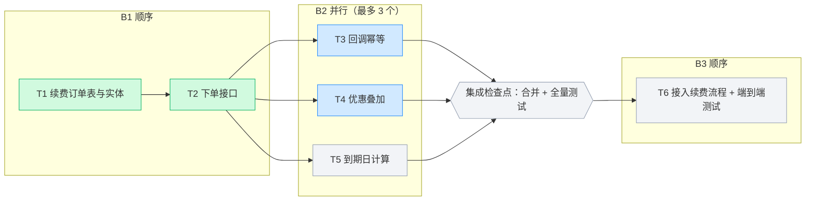

# 03 技术方案

> 历史方案快照（2026-10-30 定稿）。当前实现状态、已知缺口与验证证据见 [implementation-status.md](impl/implementation-status.md) 与 [release/v0.1.0.md](release/v0.1.0.md)。

> 本文中凡是标"P0 实测"的接口行为，最初只在官方 README 里确认过；**P0 探针与实现已完成，结论见 [spike-report.md](spike-report.md) 与 [implementation-status.md](impl/implementation-status.md)**。官方 README 副本见 [reference/dsh-0.2.1-rc.5/](reference/dsh-0.2.1-rc.5/)。

---

## 1. 架构总览

### 1.1 组件

| 组件 | 运行位置 | 职责 |
|---|---|---|
| `core`（纯 TypeScript，不依赖 DSH） | 任意 | 状态机、规则引擎、命令分词、产物解析与检查、证据解析、风险判定、指标、HTML 报告生成 |
| `host`（DSH 宿主插件） | DSH 宿主进程 | 把 `core` 接到 DSH：工具守卫、事件监听、命令、模型工具、技能、任务派发与审查子 agent、文件存储 |
| `client`（DSH 浏览器插件，React） | Web / Desktop 渲染进程 | 输入框状态条、右侧栏面板 |
| `skills/`（Markdown） | 由 host 注册为技能提供方 | 改写后的方法论：路线图、澄清、上下文、设计、拆解、TDD、排障、范围、验证、审查、QA、交付、复盘、只读分析 |
| 项目文件 | 被管理项目的仓库 | 全部在 `.flowgate/`：需求、规格、任务、执行图、台账、进行状态、运行态（`state/`）和并行 worktree（`worktrees/`）；默认整个目录不进 git |

### 1.2 分层



### 1.3 为什么这样分

- DSH 还在 RC 阶段，每个版本都可能有破坏性变更（`0.2.0 → 0.2.1` 就有十几条迁移项）。把所有判断逻辑放在不依赖 DSH 的 `core` 里，升级时只改薄薄的 `host` 适配层。
- `core` 可以脱离 DSH 做单元测试和回放测试，误伤回归用例可以直接写成测试数据。
- 发布时打成**一个** npm 包（宿主入口 + 浏览器入口 + 技能目录），安装简单；源码按目录分层，用 lint 规则禁止 `core` 引用 `@deepseek-ai/*`。

## 2. DSH 扩展点映射

| 需要的能力 | DSH 接口 | FlowGate 的用法 | 状态 |
|---|---|---|---|
| 写操作硬拦截 | `ctx.tools.guard(guard)` | 阶段策略、任务范围、受保护路径、TDD 顺序的确定性拒绝；守卫是单调的，后续监听器无法把拒绝翻成允许 | 文档确认；P0 实测能否读到目标路径和命令文本 |
| 风险转人工 | 同一个 `ctx.tools.guard` | 命中风险触发器时拒绝并生成待处理项，不返回"询问"（原因见 2.2）；`tools/pre-execute` 只在 H1 不成立时作为替代 | 文档确认 |
| 事后检测、证据采集 | `tools/post-execute`、`tools/result` | 读 shell 类工具的输出和退出码；对比工作区；记录证据 | P0 实测能否读到 bash 的输出 |
| 调用前后的工作区快照 | `tools/execute`（环绕分发的包装层） | 只把这次调用期间产生的改动算给 agent；两次调用之间的改动记为"非 agent 改动" | 文档确认；P0 实测（H17） |
| 测试输出压缩 | `tools/post-execute`（可替换结果内容） | 先解析出证据，再把测试和构建输出换成摘要，全文存文件 | 文档确认；P0 实测（H19） |
| 每步注入状态 | `agent/pre-step`（enter 分支追加消息）、`ctx.systemPrompt.section` | 注入当前阶段、允许的动作、当前任务、下一步 | 文档确认；P0 实测哪种方式对 KV cache 影响小 |
| 拦住"宣布完成" | `agent/turn-stopping` + steer | 轮次即将结束、agent 声称完成却没有新鲜证据时，让轮次继续（每轮最多 2 次） | 文档确认；P0 实测 |
| 中途通知 agent | `handle.agent.inject()` | 人工批准、退回、放行之后告诉 agent（不唤醒，下一步生效） | 文档确认 |
| 结构化提问 | `ask_user_question`（`ctx.userQuestions`） | S1 澄清访谈；子 agent 不能调用，所以访谈只能由主 agent 发起 | 文档确认 |
| 人工专属动作 | `ctx.commands.register` | `/flow` 命令族；命令和结果不进入模型消息，模型无法触发 | 文档确认 |
| 会话内状态 | `session.append(type, data)` + `ctx.sessionProjections.register` | 写插件自己的事件；投影给面板 | P0 实测能否写自定义事件类型 |
| 跨会话状态 | 宿主进程 Node `fs` | 读写 `.flowgate/`；台账、进行状态、租约都在这里 | 无风险 |
| 模型工具 | `ctx.tools.register(defineTool(...))` | `flow_*` 工具（第 10 节） | 文档确认 |
| 技能 | `ctx.skills` 提供方，或 `dsh-skill-filesystem` 的 `bundledSkillDir` | 注册内置方法论技能 | M0 选型 |
| 审查子 agent | `ctx.subagents.startActivation` + 只读取证 preset + `outputSchema`（备选 `ctx.workflowEngine.start`） | 干净上下文、只读工具、结构化输出 | dsh-task-engine 已在 rc.3 上使用；P0 实测 |
| 任务派发子 agent | `ctx.subagents.startActivation`（进程内 spawn，`delivery: 'caller'`）+ 独立 agent preset | 一个任务一个全新子 agent；限定工具；写入范围按任务套用守卫 | P0 实测（H18、H20） |
| 子 agent 工作目录 | `startActivation` 的 `cwd` | 并行任务的子 agent 在各自的 worktree 里工作 | 文档确认；P0 实测（H21） |
| 并行隔离 | 宿主进程直接调用 `git worktree add / remove` | 每个并行任务一个独立检出目录和分支 | 不依赖宿主接口 |
| 并发上限 | 宿主设置 `maxActiveSubagents`（默认 8） | 插件的并行上限默认 3，且不超过宿主上限 | 文档确认 |
| 会话生命周期 | `session/disposed` 等会话事件 | 会话关闭时释放租约、把运行中的任务标为中断 | P0 实测（H23） |
| 工程模式与子 agent preset | 在 `cordis.patch.yml` 里插入 `@deepseek-ai/dsh-agent-preset` 行 | FlowGate 工程模式、执行者、只读取证三个 preset（2.4 节） | dsh-task-engine 已这样声明；P0 实测（H25） |
| 关闭原生委派、强制原生工具模式 | `ctx.tools.restrict({ deny })` + 守卫；`ctx.tools.presentAs('native')` | 受管控会话里子 agent 只能由 FlowGate 派发，也没有 `run_code` 嵌套调用 | dsh-task-engine 已在 rc.3 上使用；P0 实测（H26） |
| 读取子 agent 的会话事件 | 会话查询服务 `sessionQuery` | 核对审查者实际读过哪些行，统计调查和审查的耗时与 token | dsh-task-engine 已在 rc.3 上使用；P0 实测（H24） |
| 右侧栏面板 | `package.json` 的 `dsh.client` + `ctx.sidebarRightTabs.register` + `ctx.slots.register({ name: 'sidebar.right.pane.tab', key })` | 8 个视图 | 文档确认 |
| 输入框状态条 | `ctx.slots.register({ name: 'conversation.input.dock', key }, Dock)` | 一行状态 | 插槽已由 ui-conversation 声明；P0 实测注册方式 |
| 面板调用宿主 | 宿主注册 Typert Remote 方法；浏览器端在 `dsh.client.inject` 里引入 `@deepseek-ai/dsh-api-gateway` 调用 | 批准、放行等按钮 | dsh-task-engine 已有 40 个 Remote 方法；codec 要同时提供 `create` 和 `schema`；兜底：按钮把 `/flow` 命令填进输入框 |
| 崩溃不丢状态 | `dsh-session-checkpoint-policy` | 复用，确保插件事件随检查点落盘 | 文档确认 |
| token 用量 | `dsh-token-meter` | 成本指标、上下文占用提示 | P0 实测；取不到则降级为步数和时长 |
| 清单与兼容 | `package.json` 的 `dsh`、`engines.dsh`、`peerDependencies` | 第 13 节 | 文档确认 |

### 2.1 为什么用守卫拦截，而不是按阶段切换可见工具

`ctx.tools.restrict()` 能把写工具从 agent 的可见集合里拿掉，看起来更"硬"。但官方说明写明：可见工具 schema 一变，KV cache 会从第一个变化的 token 起失效，每次阶段切换都要重算整段前缀，成本高。守卫不改变工具面，拒绝结果只追加在历史末尾。因此：主 agent 一律用守卫；只有生命周期固定的审查子 agent 用 restrict 收窄成只读工具集。

### 2.2 为什么人工门不走 DSH 的审批流程

`dsh-user-approval` 的应答者"可以是人类或机器"。你的 `desktop` profile 启用了 `dsh-experimental-auto-review`，它提供的 Auto 预设由一个 reviewer 模型代答审批请求。如果 FlowGate 的人工门走 `approval/request`，就可能被机器批准。因此人工门的实现是：**拒绝当前动作 → 生成待处理项 → 只能通过 `/flow` 命令或面板按钮处理**。命令只由你在输入框输入时触发，不会变成模型消息。

### 2.3 威胁模型

防的是"认真但爱走捷径的 agent"：跳步、拿旧证据宣布完成、越界改文件、为了过门禁改写产物或测试。`dsh-perm-gate#2` 就是典型：计划里出现了被禁止的关键词，模型就改写计划去绕开它，计划质量反而下降。

对策是"检查结构和证据，不检查措辞"：门禁看六要素是否齐全、场景是否可测、证据是否新鲜、改动是否在范围内，不做关键词黑名单。FlowGate 不防恶意用户，也不做加密沙箱；手段是确定性的代码检查、篡改检测和完整留痕。

### 2.4 启用范围与工程模式

- **只在初始化过的项目生效**：插件检查会话工作目录所在的项目里有没有 `.flowgate/config.yaml`。没有就不拦截任何操作，状态条只显示"FlowGate 未启用 · /flow init 启用"；有了才进入门禁。
- **初始化后所有会话都受管控**：无论会话用的是哪个 preset，只要工作目录在受管控的项目里，门禁照常生效，规则通过 `system-prompt/assemble` 注入。
- **FlowGate 工程模式**：随插件提供一个 Agent Preset，写在 `cordis.patch.yml` 里（插入 `@deepseek-ai/dsh-agent-preset` 行，dsh-task-engine 的"工程化开发引擎"就是这样声明的）。它调好人设、工具集、计划模式引导和上下文压缩参数（例如 `dsh-compaction-tool-result-pruner` 的阈值），在受管控的项目里推荐使用。
- **委派只能走 FlowGate**：受管控的会话里用 `ctx.tools.restrict({ deny })` 关闭 DSH 原生的委派工具（`subagent`、`subagent_fork`、`workflow`、`send_message` 等），守卫再兜一层：换个名字调用也会被拒绝，并提示改用 `flow_dispatch_next` 或 `flow_investigate`。同时用 `ctx.tools.presentAs('native')` 强制原生工具调用，不出现 PTC 的 `run_code`，嵌套调用绕过守卫的问题也就不存在了。
- **两个专用子 agent 模式**：执行者 preset 有读写文件、shell 和 FlowGate 的任务工具，没有委派工具；只读取证 preset 只有 read、glob、grep 和结构化输出，没有写文件，也没有 shell，用于审查和调查。能力边界首先由工具集保证，守卫是第二层。

## 3. 状态机

### 3.1 状态与转移



（锁定模式可以从任意阶段进入，`/flow repair` 恢复到原阶段；图里只画了两条示意。）

### 3.2 门禁定义

每个门是一组检查项；每个检查项都有：`id`、说明、判定函数、失败时的提示和示例。

| 门 | 类型 | 检查项（以中复杂度 · 普通风险为例） |
|---|---|---|
| GR（仅从 0 开发） | 人工 | 项目级六要素闭合；能力拆分无遗漏、依赖无环；第一个变更是工程骨架；每个变更预计 ≤ 12 个任务；MVP 切线已标出 |
| G0 | 自动 | 变更目录已创建；标题和一句话目标非空；复杂度和风险已建议；契约已冻结 |
| G1 | 人工 | 六要素各有结论或被接受为假设；每条需求 ≥ 1 个场景；场景的 THEN 无未量化模糊词；"不做"清单非空；未决问题 = 0；增量规格格式合法 |
| G2 | 自动 | `context.md` 必填段非空；`project.md` 命令可执行；基线已记录：声明了测试命令时至少跑到一个测试，`test: none` 时用构建、类型检查和 lint 作基线；工程骨架变更 C0 允许 0 个测试 |
| G3 | 人工 | `design.md` 有 2–3 个方案对比和推荐；`risk.md` 五类齐全；任务卡检查全部通过（含任务数 ≤ 12）；追溯矩阵无未覆盖场景；执行计划通过检查（依赖顺序、并行任务范围不重叠、不碰热点文件，见 9.3）；工作区没有未提交的改动（进入 S4 时要创建变更分支） |
| TG（任务门） | 自动 | 当前输入下有效的 GREEN 回执（由 `flow_verify` 产生）；TDD 任务有更早的 RED 回执；工作区无范围外改动；审查读取覆盖完整、无未处理的 critical / major（审查强度按风险） |
| G4 | 自动 | 按执行图完成全部批次：每个任务通过任务门，每个并行批次通过集成检查点 |
| G5 | 自动 | 全量测试相对基线无回归；lint / build 通过；验收场景全部有通过证据；运行证据（按风险）；终审无未处理 critical / major |
| G6 | 人工 | 交付清单（FR-7.1）全部满足；手工证据已确认（高风险时逐条确认）；篡改检测项已确认 |

门禁定义是数据（内置默认 + `.flowgate/config.yaml` 覆盖），复杂度和风险决定哪些检查项生效（见 `02` 的 4.2 节和本文 3.8 节）。

### 3.3 提交与审批时序（以 G1 为例）

1. agent 调用 `flow_submit({ gate: "G1" })`。
2. core 运行检查项。不通过 → 返回 `{ passed: false, failures: [{ item, hint, example }] }`，agent 继续修改。
3. 通过 → 状态变为"等待负责人"，状态条显示"等你批准需求定稿"，面板门禁视图出现【批准】【退回】按钮；agent 被要求结束本轮，告诉你去确认。
4. 你执行 `/flow approve G1` 或点按钮 → 命令处理器写账本、追加会话事件、进入 S2，并用 `inject()` 告诉 agent 已批准。
5. 你执行 `/flow reject <意见>` → 留在 S1，意见注入给 agent。

### 3.4 低复杂度：合并确认

低复杂度时 S1 到 S3 连续推进：G1 的检查项照常执行，不通过照样退回给 agent，但通过后不停下来等你；S2 自动使用 `project.md` 并跑基线；S3 只生成 1 张任务卡。到 G3 时，插件把两个门的内容合成一张"方案确认卡"：

```text
方案确认（低复杂度 · 普通风险）
目标：首页购买按钮的文案"立即购买"改为"马上抢购"
验收：GIVEN 打开首页 WHEN 页面加载完成 THEN 按钮显示"马上抢购"（中文、英文文案各一条场景）
范围：src/pages/Home.tsx、src/locales/zh-CN.json、src/locales/en-US.json
验证：pnpm lint && pnpm test（快照更新 1 处）
[确认]  [退回并写意见]  [提高复杂度]
```

你确认一次，账本里同时记下 G1 和 G3 的 `gate.approved`。之后照常走 S4 → S5 → G6。高风险时，卡片上多一栏风险项（含回滚方案），逐项确认后才能通过。

### 3.5 项目级路线图（从 0 开发）

触发条件：会话工作目录是空仓库（除 README、LICENSE 外没有源码），或负责人用 `/flow new --project` 声明这是新项目。

1. **项目级澄清**（`flow-roadmap` 技能）：问目标用户、核心流程、MVP 做什么和不做什么、技术栈与部署、非功能要求。空仓库没有代码可挖，"先挖后问"改为先读你提供的材料（需求文档、竞品链接、草图）。产出 `.flowgate/project-clarify.md`。
2. **拆路线图**：按能力拆成变更，写进 `.flowgate/roadmap.md`（格式见 9.7）。一个变更对应一个能独立验收的能力，预计不超过 12 个任务；第一个变更固定是工程骨架 C0。
3. **GR**：插件检查依赖无环、每项 MVP 能力都有归属、C0 在首位、规模估计合理；通过后等你批准。
4. **逐个变更推进**：`flow_new_change({ fromRoadmap: "C1" })` 立项，自动带入路线图里的目标、验收要点和项目级决定；S1 只补这个能力的细节。
5. **C0 的特殊规则**：G2 允许 0 个测试；G5 要求测试框架真实跑通至少一个测试。C0 交付时生成项目级 `project.md`，后续变更以它的测试结果为基线。
6. **路线图变更**：要增删能力、挪动 MVP 切线时，写路线图增量并重新过 GR。

### 3.6 会话边界、交接摘要与跨会话接续

- **台账是入口**：全部变更的编号、阶段、状态和最近会话都在 `.flowgate/changes/index.md` 与各变更的 `status.json` 里；面板和看板都从这里读，不依赖当前会话。
- **自动接续**：新会话开始时插件扫描台账。只有一个进行中的变更且没有被别的会话占用，就自动附着，注入它的交接摘要和当前任务卡，状态条显示"已接续 C-003 · S4 · B2 并行 2/3"；有多个进行中的变更时不自动附着，状态条提示用 `/flow resume` 选择，面板台账视图每行都有【继续】按钮。
- **租约**：同一个变更同一时间只附着在一个会话上。附着的会话每一步刷新心跳（`state/sessions.json`）。另一个会话想继续它时，如果心跳在 10 分钟内（可配置），提示"正在另一个会话中进行"，你可以用 `/flow resume C-003 --takeover` 接管，原会话之后的写操作会被拒绝并提示"已被接管"；心跳超时则直接接管。会话关闭（`session/disposed`）时自动释放租约。
- **暂停与恢复**：`/flow pause` 写交接摘要、释放租约；如果正处在 S4 且主工作区有未提交的改动，先做一次 WIP 提交到变更分支，这样你可以切去做别的变更。`/flow resume` 恢复。
- **中断的任务**：会话关闭时还在运行的子 agent 会随之停止，对应任务标为"中断"。worktree 和已记录的证据都保留；接续后重新派发，新的子 agent 在同一个 worktree 里接着做，并拿到上一次的摘要和当前 diff。重新派发前，插件先向宿主确认旧的子 agent 及其后代都已停止、资源已释放；确认不了就保持阻塞并生成待处理项，避免两个 agent 同时写同一个 worktree。
- **会话之间的改动**：接续时重新拍快照，与上次记录的快照对比，期间出现的改动记为"非 agent 改动"，交给你确认。
- **同一工作目录的约束**：可以有多个未完成的变更（例如暂停一个功能去修紧急 bug），但同一个工作目录里同一时间只能有一个变更处于 S4–S6。
- **交接摘要**：每通过一个门、每完成一个任务，插件根据账本和产物生成一段不超过 300 字的摘要（已定的决定、当前阶段和任务、未决事项、下一步），写入 `changes/<id>/handoff.md`（只有插件能写）和账本。
- **注入时机**：新会话的第一步、DSH 压缩上下文之后的第一步，优先注入最新的交接摘要和当前任务卡，然后才是常规的运行时上下文。
- **一个变更一个会话**：G6 通过并归档后，状态条提示"建议开新会话"；新会话只带 `project.md`、`roadmap.md`（如有）、相关主规格和最新交接摘要。
- **上下文占用**：能读到 token 用量时，占用超过 60%（可配置）就提示开新会话，并立即生成一份交接摘要。
- **门禁不依赖会话**：判定全部在宿主代码里，状态从文件恢复，换会话、压缩上下文都不影响拦截。

### 3.7 只读分析任务

"为什么会这样""这条调用链怎么走""几个方案选哪个"这类需求不改代码，走分析任务：

1. **立项**：`flow_new_change({ kind: "analysis", title, reason })`，编号为 `A-<序号>`。插件用 `restrict` 把工具收窄到 read、glob、grep 和 FlowGate 工具，写文件、执行命令都会被拒绝。
2. **查证**：主会话直接读源码；大仓库里可以用 `flow_investigate({ questions, benefit })` 派只读调查子 agent（默认最多 2 个同时运行），每个子 agent 只回答一个具体问题，回传带引用的报告。插件记录每次调查的耗时和 token，取不到的标为"未知"。
3. **提交**：`flow_submit_analysis({ conclusion, proposal, limitations, citations })`。引用格式见 9.9 节；插件读取原文、记录哈希并核验，引用不成立就拒绝提交。核验只能证明"引用的代码确实存在、内容一致"，结论对不对仍要你判断。
4. **归档**：通过后写入 `changes/A-xxx/analysis.md` 并归档，不经过测试、审查和交付阶段。
5. **转实施**：要动手改时，用 `flow_new_change({ relatedTo: "A-002" })` 新建关联变更，S1 直接引用分析结论和证据，不重复调查。

### 3.8 复杂度与风险

流程等级分两个维度，各管一件事（取值和对应的检查项见 `02` 的 4.2 节）：

- **复杂度（低 / 中 / 高 / 超高）决定流程有多长**：走哪些阶段、写哪些产物、要不要设计文档和执行计划、人工确认几次。
- **风险（普通 / 高风险）决定检查有多严**：TDD 是否全部必需、审查几轮、要不要安全审查、运行证据和回滚方案是否必需、风险项是否逐项确认。

两个维度独立组合。例如只改支付回调验签里的一处判断，是"低复杂度 · 高风险"：不用写设计文档，只有一张任务卡，但 TDD 全部必需，两轮审查加安全审查，风险项逐项确认。

- **谁来定**：插件根据信号（关键词、预计涉及的路径、模块数量、敏感路径触发器）分别给出建议和理由，负责人在 G1（低复杂度时在方案确认卡上）确认。
- **提高**：agent 可以申请提高任何一个维度，立即生效。风险提高后，已完成任务的审查按新标准重新要求，测试回执保留；如果已经进入 S5 或 S6，退回 S4。复杂度提高后回到 S3 补设计和执行计划，已完成且不受影响的任务保留。
- **降低**：只能由负责人用命令执行（`/flow complexity`、`/flow risk-level`），并且要写理由。

## 4. 规则引擎

### 4.1 规则长什么样

```yaml
# 内置默认，可在 .flowgate/config.yaml 的 rules 下覆盖或追加
- id: R-STAGE-SRC
  when:
    stage: [S0, S1, S2, S3]
    action: write            # write | create | delete | shell-mutation | dependency | push | read-secret
    path: "**"
    except: [".flowgate/changes/{change}/**"]
  decision: deny             # deny | human（转人工） | allow
  why: 先定"做什么"再动代码：需求和计划获批之前不写源码。
  unlock: 完成当前阶段产物并调用 flow_submit；确需立即修改，请负责人执行 /flow allow-once R-STAGE-SRC <理由>
  source: OpenSpec——proposal 获批前不写代码
- id: R-SCOPE
  when: { stage: [S4], action: [write, create, delete], outside: task.scope }
  decision: deny
  why: 只改当前任务范围内的文件，避免顺手重构和改变原有行为。
  unlock: 用 flow_request_scope_change 说明要加的路径和理由，等负责人批准
  source: gstack /freeze；Superpowers writing-plans 的"精确文件路径"
- id: R-DEP
  when: { stage: [S4, S5], action: dependency }
  decision: human
  why: 新增或升级依赖涉及供应链安全和许可证合规。
  unlock: 等负责人在面板批准该次依赖变更
  source: 工程判断——合规与安全
```

### 4.2 判定顺序

受保护路径 → 锁定模式 → 风险触发器（转人工）→ 阶段策略 → 任务范围 → 新文件控制 → TDD 顺序 → 例外与单次放行 → 默认允许。前面的规则一旦拒绝，后面不再翻转（与 DSH 守卫的单调语义一致）。单次放行只抵消它指定的那条规则，不会放过其他规则。

### 4.3 工具分类与覆盖自检

| 类别 | 例子 | 如何判定动作 |
|---|---|---|
| 只读 | read、grep、glob、web_fetch、`ask_user_question` | 不拦截；读密钥文件和插件密钥除外 |
| 文件写入 | write、edit | 事前判定：参数里的目标路径 |
| shell | bash、pwsh、`run_code` | 事前：命令分词，只匹配危险命令和推送；事后：工作区对比 |
| 委派 | 子 agent、workflow | 受管控会话里原生委派工具被关闭（2.4 节）；子 agent 只能由 FlowGate 用指定 preset 启动，启动后按它的任务范围判定 |
| MCP 与未知工具 | `mcp__*` | 名称或 schema 能识别为写操作的按写入判定；无法分类的在门禁阶段转人工 |
| FlowGate 工具 | `flow_*` | 按工具自身的阶段约束 |

会话开始时调用 `ctx.tools.schemas(scope)` 枚举 agent 可见的全部工具，逐个分类；面板"拦截"视图顶部显示"已覆盖 N 个可写工具，未分类 M 个"，未分类的标红。

### 4.4 命令分词（防误伤）

- 按 shell 语法切分出每一段命令（`&&`、`||`、`;`、`|`、子 shell、反引号），只在**命令位置**匹配命令名和危险参数。
- 引号内的字符串、`node -e` / `python -c` 的脚本内容、heredoc 正文不参与危险命令匹配，但会做"写入路径"的事后检测。
- 回归用例至少包含 `dsh-perm-gate` 的 3 个误伤（`=>`、计划正文里的关键词、写模式判定），以及 `cc-safety-net` 公开的漏检绕过（`git -C <dir> push --force`、`rsync --delete`）。

### 4.5 解释器输出

给 agent 的短版（进入工具结果，尽量短）：

```text
FlowGate 拒绝：S3 设计拆解阶段不能写源码（R-STAGE-SRC）。
解锁：完成 tasks.md 后调用 flow_submit({ gate: "G3" })，等负责人批准。
```

给人的完整卡片（面板"拦截"视图）：时间、工具、目标、规则 id、为什么、方法来源、怎么解锁、按钮【误判·放行一次】【加入例外】【复制证据】。

## 5. 范围控制

### 5.1 事前检查（write / edit）

允许写入的集合 = 当前任务的 `scope` ∪ `tests` ∪ `new_files` ∪ 本变更允许 agent 写的产物；`new_files` 之外的新建文件按"新文件控制"处理。路径统一规范化成仓库相对路径后匹配 glob。

### 5.2 事后检测（shell 和委派）

- 用 `tools/execute` 包装层在每次 shell 类工具调用**之前和之后**各采集一次工作区快照：`git status --porcelain=v2 -z` 的结果，加上已改动文件的内容哈希。
- 两次快照的差异就是这次调用产生的改动；其中落在允许集合之外的记为越界。
- 上一次调用结束到这一次调用开始之间出现的改动（你在编辑器里手动改的、格式化工具或文件监听程序改的）不算越界，记为"非 agent 改动"：面板提示，G6 单列给你确认。
- `.gitignore` 忽略的文件不参与（构建产物、缓存）；另外支持在 `config.yaml` 的 `ignore` 里追加。
- `.flowgate/` 下由插件自己写的文件不参与归因；agent 对 `.flowgate/` 的写入由守卫拦截（并行任务的子 agent 写自己的 worktree 除外）。
- 并行批次里每个 worktree 单独拍快照、单独归因：一个 worktree 里的改动只可能来自它自己的子 agent。
- 如果 `tools/execute` 无法包裹异步快照（H17 不成立），退回到"任务开始时快照"，并把无法归因的改动标为"来源不明"，交给你在面板判断。

### 5.3 越界后怎么处理

1. 记一条越界事件，面板标红。
2. 本任务后续所有写入被拒绝（撤销操作除外），提示 agent：要么 `git checkout -- <文件>` / 删除新增文件把改动撤回，要么申请范围变更。
3. 再次检测通过后自动解除。

### 5.4 防"重复造轮子"

- `project.md` 维护"可复用模块清单"（工具类、通用服务、组件），S2 的上下文包会引用它。
- 新建文件必须事先写在任务卡的 `new_files` 里，G3 时由你看过。
- 审查子 agent 的检查清单包含"是否与已有模块重复"。

### 5.5 非 git 项目

只做事前检查；面板标黄"范围检测降级：不是 git 仓库"；`/flow init` 会建议执行 `git init`。

### 5.6 删除与重命名

- 任务卡的 `changes` 字段声明要删除或重命名的文件（`{ path, kind: delete }` 或 `{ path, kind: rename, to }`），旧路径和新路径都算进任务范围。
- 动手之前，插件从 git 取出这些文件的原内容；有未提交改动的，另存一份快照。审查子 agent 必须读完原内容和改后的文件，审查才算通过。
- 没有声明的删除或重命名一律拒绝；删除受版本控制的文件会把变更的风险提高为高风险（8.2 节）。
- 取不到完整的 git 文本原内容（二进制、过大、被截断）时，明确阻塞，转人工处理。

## 6. 证据与 TDD

### 6.1 证据记录

```json
{
  "id": "E-0042",
  "change": "C-003",
  "task": "T3",
  "group": "renewal-unit",
  "kind": "test",
  "phase": "green",
  "command": "./mvnw -B -q -Dtest=RenewalCallbackTest test",
  "runBy": "flowgate",
  "exitCode": 0,
  "summary": { "parser": "junit-xml", "run": 6, "passed": 6, "failed": 0, "skipped": 0 },
  "inputsHash": "sha256:9f2c…",
  "outputRef": ".flowgate/state/evidence/E-0042.log",
  "startedAt": "2026-11-12T10:30:28+08:00",
  "finishedAt": "2026-11-12T10:31:05+08:00"
}
```

### 6.2 验证由插件执行（`flow_verify`）

- agent 调用 `flow_verify({ taskId, group })`，插件按任务卡里该验证组声明的命令亲自执行（带超时），把结果写成回执。只有这种回执能当 RED / GREEN 证据；agent 自己在 shell 里跑的测试只作参考，不改变任务状态。
- 命令形状受限：不允许 `&&`、`||`、`;`、管道、重定向、命令替换和反引号，避免 `npm test || true`、`mvn test | tee log` 这类写法掩盖失败。
- 推荐写法：Maven 用 `mvn -B test`（或 `./mvnw -B test`）；Gradle 用 `./gradlew test --rerun-tasks`，避免任务被判为"已是最新"而没有真正执行；Go 用 `go test -json ./...`。
- 命令只能来自两处：任务卡的 `verify` 验证组，或 `project.md` 的 `test` 命令；agent 不能临时改写。

### 6.3 输出解析（优先读报告文件）

| 工具链 | 首选来源 | 兜底 |
|---|---|---|
| Maven Surefire | `target/surefire-reports/*.xml`（命令开始之后修改过的） | 解析 `Tests run: X, Failures: Y, Errors: Z, Skipped: W` |
| Gradle | `build/test-results/**/*.xml` | 解析控制台摘要 |
| Vitest / Jest | 注入 JSON 或 JUnit reporter 参数（可选），否则读控制台摘要 | 退出码 |
| pytest | `--junitxml`（可选注入），否则解析 `N passed, M failed` | 退出码 |
| go test | `-json` 输出（只有包级 ok、全部跳过或没有测试的包，都不算有用例通过） | — |
| cargo test | 控制台摘要 | 退出码 |

解析不出测试数量时，证据标为"未解析"：只能当 GREEN 的辅助证据（退出码 0），不能当 RED（RED 需要看到失败数量）。

### 6.4 按输入范围判断回执是否过期

- 每个验证组在任务卡里声明自己的输入：相关源文件、测试文件、构建配置和依赖锁文件（例如 `pom.xml`、`package.json` 和锁文件）。
- 回执记录执行时这些输入的哈希（`inputsHash`）。只要这些输入没变，回执就一直有效；其中任何一个文件变了，回执过期，需要重新 `flow_verify`。
- 同一组以最新一次结果为准：更早的通过记录不能覆盖之后的失败。
- 好处是只改前端时，后端验证组的回执不会失效；并行批次里各任务的回执互不影响。这仍是 Superpowers"没有新鲜的验证证据就不能宣称完成"的代码化版本，只是"新鲜"按输入判断，而不是按整个工作区判断。

### 6.5 任务内的 TDD 状态

```text
none ──(测试文件被修改 + 跑出失败)──▶ red ──(跑出全部通过)──▶ green ──(重构后再次全部通过)──▶ green
```

- 高风险变更的全部任务，以及普通风险下标为 `tdd: required` 的任务：在 `red` 之前写实现文件（不在 `tests` 范围内的文件）会被 R-TDD-ORDER 拒绝。RED 和 GREEN 都以 `flow_verify` 的回执为准。
- 豁免：任务卡写 `tdd: optional` 并附理由（例如纯配置、文档、样式），G3 时由你看过；高风险时豁免要额外人工批准。

### 6.6 拦住"宣布完成"

监听 `agent/turn-stopping`：当前处于 S4 / S5，并且同时满足下面两点时，用 steer 让轮次继续，注入"请运行验证命令，并用输出证明"：

1. 最后一条 assistant 消息里有完成类表述（完成、已修复、全部通过、done、fixed、passing 等）；
2. 活动任务没有当前输入下有效的 GREEN 回执。

每轮最多触发 2 次，防止死循环；触发次数计入 M-4。

### 6.7 测试输出压缩

`flow_verify` 的结果，以及 agent 自己跑的测试、构建或 lint 命令，执行完后都在 `tools/post-execute` 里按顺序做两件事：先用完整输出（和报告文件）解析出证据，再把进入上下文的结果换成摘要：

```text
[FlowGate] ./mvnw -q test → 失败（运行 48，通过 46，失败 2，跳过 0），用时 37s
失败 1：RenewalCallbackTest.duplicateCallbackIsIgnored
  expected: <2026-12-01> but was: <2026-12-31>
  at RenewalService.renew(RenewalService.java:88)
失败 2：……
完整输出：.flowgate/state/evidence/E-0057.log（可用 read 查看）
```

默认上限 400 token；全部通过时只保留第一行。非测试命令的大输出交给 DSH 自带的 spill 策略（需要在 profile 里配置 `maxInlineTokens`）。

### 6.8 返工与失效范围

返工时先声明类型，插件据此决定哪些回执和审查作废：

| 返工类型 | 什么会失效 | 什么会保留 |
|---|---|---|
| 缺陷返工（指定受影响的任务） | 这些任务，以及沿 `depends_on` 依赖它们的下游任务的回执和审查；整个变更的终审 | 其他任务的回执和审查 |
| 需求变更、方案变更 | 全部回执和审查，回到 S1 或 S3 | 历史记录（只作留痕） |
| 影响不明 | 全部回执和审查 | 历史记录（只作留痕） |

几个任务共用的输入（例如同一个配置文件）变化时，按 6.4 节的输入哈希自动扩大失效范围。

## 7. 审查

### 7.1 审查子 agent

- **怎么创建**：用 `ctx.subagents.startActivation` 启动，指定只读取证 preset（2.4 节）和结构化输出 schema（`outputSchema`），dsh-task-engine 在 rc.3 上就是这样做的；备选是 `ctx.workflowEngine.start` 脚本里的 `agent(prompt, { schema })`。
- **输入**：任务卡、覆盖的场景、`context.md` 相关片段、该任务的 diff（任务开始快照 → 当前）。
- **只读工具**：read、grep、glob，以及 FlowGate 提供的 `flow_diff`（只读）。
- **读取覆盖核对**：插件通过会话查询服务（`sessionQuery`）读取审查子 agent 的会话事件，核对它实际读到的行是否覆盖全部待审文件和 diff（删除的文件按 5.6 节核对原内容）。被截断、漏读的部分不算读过；覆盖不完整的审查不算数，要求重审。
- **只认结构化提交**：结论必须通过结构化输出提交；只有自由文本，或者结构化结果校验失败，都不算有效审查。
- **输出 schema**：

```json
{
  "verdict": "pass | changes-required",
  "findings": [
    { "severity": "critical | major | minor", "file": "…", "line": 42,
      "rule": "spec-mismatch | missing-test | duplicate-logic | unrelated-change | error-handling | security | naming",
      "message": "…", "suggestion": "…" }
  ]
}
```

### 7.2 审查轮次

- 普通风险：低复杂度不做逐任务审查，S5 做一次终审；中、高、超高复杂度每个任务一轮综合审查。
- 高风险：每个任务两轮——先查"是否符合规格"（场景是否真被实现、有没有多做），再查"代码质量"；S5 终审加一轮安全审查（OWASP 常见问题、密钥、注入、鉴权绕过）。

### 7.3 发现怎么处理

critical：任务门不通过，必须修复；major：修复，或由你在面板豁免并写理由；minor：记录，出现在报告里。审查结论写入 `changes/<id>/review.md`（只有插件能写）。

### 7.4 成本控制

审查模型可单独配置；输入只给 diff 和相关片段，不给整个会话；同一 diff 指纹不重复审查；审查子 agent 启动失败（例如宿主暂时不可用）不消耗审查轮次。

### 7.5 按执行图派发：顺序与并行

S3 产出的执行计划（9.3 节）把任务分进若干批次，每个批次标明"顺序"或"并行"。G3 批准后，派发严格按这张图走：主会话不能改顺序，也不能跳过批次。

- **谁来派发**：主 agent 调用 `flow_dispatch_next()`。插件的调度器找出下一个可以开始的批次，按批次类型启动子 agent，并立即返回这次启动的任务清单。子 agent 结束、任务门和审查都完成后，插件用完成通知告诉主 agent，主 agent 再调用 `flow_dispatch_next()` 进入下一批。主会话在 S4 负责调度、转达问题和处理失败；除了标为 `run: main` 的任务，主会话不直接改源码。
- **哪些任务派子 agent**：任务卡的 `run` 写 `main`（主会话直接做）或 `subagent`（派子 agent）；选 `subagent` 要写 `run_reason`，理由只能是需要并行、需要隔离上下文或需要独立核对。默认 `dispatch: auto`：并行批次里的任务和规模为 M 的任务派子 agent，顺序批次里规模为 S 的小任务由主会话直接做。文件彼此独立本身不是派子 agent 的理由。
- **怎么创建子 agent**：插件用 `ctx.subagents.startActivation` 在进程内启动全新的子 agent（`delivery: 'caller'`，由插件等待结果），使用 FlowGate 自带的"执行者" preset：只开放读写文件、shell 和 FlowGate 的任务工具，不开放委派和 `ask_user_question`。子 agent 拿到任务卡、覆盖的场景、`context.md` 的相关片段、验证命令、TDD 要求和最新交接摘要，不带主会话的聊天历史。
- **顺序批次**：一次只跑一个任务，按批次里列出的顺序执行；子 agent 在主工作区（变更分支 `flowgate/<变更>`）里工作。
- **并行批次**：同时跑多个任务，默认最多 3 个（`parallel.max_agents`，不超过宿主的 `maxActiveSubagents`），多出来的排队。每个任务先在 `.flowgate/worktrees/<变更>/<任务>/` 建一个独立的 git worktree（分支 `flowgate/<变更>/<任务>`，从批次开始时的变更分支头创建），执行 `parallel.setup` 准备命令（如 `pnpm install --frozen-lockfile`），再以这个目录为 `cwd` 启动子 agent。
- **槽位级补位（2026-10-31 起）**：并行批次里任一执行者结算（成功或失败）后，宿主立即按执行图补派同批次下一个 queued 任务，不再等主 agent 再次调用 `flow_dispatch_next`；超出 `max_agents` 的任务显式标为 `queued`（面板/状态可区分"排队中"）。主 agent 仍负责批间推进（等集成检查点结论后再进下一批）。
- **守卫怎么管它们**：每个子 agent 的写入范围就是它的任务范围（相对于它自己的工作目录），写别的 worktree 或主工作区都被拒绝；阶段、TDD、风险、受保护路径的规则与主 agent 相同。区分调用方 agent 依赖 H18 和 H22：不成立时顺序派发照常可用（同一时间只有一个子 agent 在写），并行批次自动降级为顺序执行并在执行图上标注，"主会话不直接改源码"只能提示和计入指标，无法拦截。
- **任务完成**：子 agent 回传结构化摘要（改了哪些文件、证据 id、遗留问题、需要你决定的问题）→ 插件跑任务门（新鲜证据、范围、TDD）→ 审查子 agent → 通过后插件在该任务所在的分支上提交一次，提交说明为 `flowgate(<变更>/<任务>): <标题>`。主会话不接收子 agent 的中间过程。
- **集成检查点**：并行批次的任务全部完成后，插件按任务顺序把各任务分支合并回变更分支，再跑每个任务的验证命令和全量测试（或 `project.md` 里的 `integration` 命令）。全部通过才进入下一批；测试失败就生成一个顺序的修复任务（范围只含失败涉及的文件）；合并冲突生成待处理项交给你。合并完成后删除这些 worktree，失败的保留以便排查。
- **一个任务失败**：同批其他任务照常完成；集成检查点要等失败的任务处理完（熔断后转人工，或由你决定移出本批）。
- **遇到需要你决定的事**：子 agent 不能提问，它会停下并在摘要里写明问题；主 agent 用 `ask_user_question` 问你，再把答案交给原来的子 agent 继续，或派一个新的子 agent 接手（取决于 H20）。并行批次里多个子 agent 同时有问题时，主 agent 合并成一轮提问。
- **主 agent 自己执行**：`dispatch: inline` 时不派子 agent，主 agent 用 `flow_task_start` 按执行图的顺序逐个做（并行批次里的任务也逐个做）；不符合执行图顺序的领取会被拒绝。

## 8. 风险引擎

### 8.1 风险登记（`risk.md`）

```markdown
| 类别 | 等级 | 理由 | 缓解措施 | 验证方式 | 需人工接管 |
|---|---|---|---|---|---|
| 安全 | 高 | 续费回调需要验签，伪造回调可以白嫖会员 | 复用 SignatureVerifier；拒绝未签名请求 | 场景 R3.S2 的测试 | 是 |
| 性能 | 低 | 每次续费多一次幂等查询 | 流水号加唯一索引 | 压测脚本（可选） | 否 |
| 成本 | 无 | 不新增外部调用 | — | — | 否 |
| 合规 | 中 | 续费记录含手机号 | 日志脱敏 | 审查检查 | 否 |
| 可维护性 | 中 | 续费规则分散在两个服务 | 收拢到 RenewalPolicy | 审查检查 | 否 |
```

### 8.2 内置触发器

| 触发器 | 条件（默认） | 动作 |
|---|---|---|
| 敏感路径 | `**/auth/**`、`**/security/**`、`**/payment*/**`、`**/migration*/**`、`**/*.sql`、`**/db/changelog/**`、`Dockerfile`、`.github/workflows/**`、`**/k8s/**`、`**/application-prod*.*` | 转人工 |
| 依赖变更 | `package.json` 的依赖段、`pom.xml` 的 `<dependencies>`、`build.gradle*`、`requirements*.txt`、`pyproject.toml`、`go.mod`、`Cargo.toml` 发生变化 | 转人工 |
| 危险命令 | `rm -rf`（作用于仓库外或仓库根）、`git push --force`、`git reset --hard`、`git clean -fd`（带 `-x` 或 `-X` 时还会删掉被忽略的 `.flowgate/`）、SQL 的 `DROP` / `TRUNCATE`、`curl … \| sh`、`chmod -R 777` | 转人工 |
| 推送 | `git push`、创建 PR 的命令 | G6 之前拒绝，之后转人工 |
| 删除受版本控制的文件 | 任务卡 `changes` 里声明的删除（未声明的删除直接拒绝，见 5.6 节） | 变更风险提高为高风险 |
| 密钥 | 写入内容匹配私钥、云厂商密钥、令牌格式；读取 `.env*` 等 | 拒绝写入；读取转人工 |
| 成本 | 本变更 token 超出复杂度对应的预算（取不到 token 时用步数） | 暂停并转人工 |
| 范围膨胀 | 一次范围变更新增超过 3 个文件或跨模块 | 转人工（申请本来就要人批，这里额外标"高"） |
| 连续失败 | 同一任务验证连续失败 3 次 | 暂停任务并转人工，注入排障指引；只拦"推进/修改"类动作（写文件、会改工作区的命令、进度类 `flow_*`），`read`/只读命令/`flow_status`/`flow_diff`/`flow_report_risk` 放行以便取证；负责人 `/flow unblock <BL-n>` 清零计数并恢复任务 |

### 8.3 待处理项的生命周期

`open → approved（单次，限定动作和路径）| rejected（附理由）| expired（任务结束仍未处理）`。每个状态变化都写账本；批准后通过 `inject()` 告诉 agent 可以重试。

编号规则：风险接管项 `RK-n`，范围变更申请 `SC-n`，计划修订申请 `PC-n`，规则提议 `RL-n`，单次放行 `OV-n`，例外 `EX-n`。

### 8.4 规则沉淀

审查发现里真实、已经修复、而且以后还会出现的问题，可以变成项目规则：

1. agent 调用 `flow_propose_rule({ finding, rule, example, scope })`，写明问题、规则内容、正确写法示例和适用范围，生成提议 `RL-n`；
2. 你用 `/flow rule approve RL-n` 确认，或用 `reject` 并写理由；
3. 插件把规则写入 `.flowgate/rules/<规则 id>.md`，挂到对应阶段的技能上。之后新建的变更自动遵守；进行中的变更按冻结的契约不受影响（9.8 节）。

一次性的误判、还没确认的意见不沉淀。复盘时会列出出现两次以上的同类审查问题，作为提议的候选。

### 8.5 误判反馈与规则自动降级（M-5）

- 负责人在面板/命令里把一次拦截标为「误判」时（`/flow allow-once <规则> 误判…`、面板"误判反馈"），记录进入账本，M-5 误判率 = 误判数 ÷ 拦截数。
- 规则级反馈按账本重建：拦截 = `rule.denied`/`rule.human`；误判 = 上述拦截或 `override.granted`/`exception.added` 中带 `misjudged` 标记、`reasonKind: 'misjudged'`、或理由含「误判」的记录。
- **自动降级**：某规则累计拦截 ≥ 20 次且误判率 > 5% 时，后续命中该规则的 deny/human 判定降为「提示」（本次放行、面板/注入展示原因、写账本 `rule.hinted` 并进入复盘；降级不改变规则定义，负责人仍可改 config/例外）。样本不足 20 次不降级，避免新规则被一两次误判放倒。
- 实现：`src/core/rules/misfire.ts`（纯函数）+ `FlowEngine.evaluateAction`（降级与 `rule.hinted` 记账）+ `metrics` M-5 备注（列出被降级规则）。

## 9. 产物与数据格式

### 9.1 目录结构（在被管理的项目里）

FlowGate 产生的全部文件都在项目根目录的 `.flowgate/` 里，它是跨会话的唯一事实来源：任何会话、面板、看板都从这里读状态。

```text
.flowgate/
  README.md                         # 目录说明（插件生成）
  .gitignore                        # 插件生成：默认内容为 *，整个目录不进 git
  project.md                        # 项目级上下文包（/flow init 生成，负责人维护）
  config.yaml                       # 规则、复杂度与风险等级、触发器、命令、并行与会话设置
  project-clarify.md                # 项目级澄清记录（仅从 0 开发时）
  roadmap.md                        # 路线图（仅从 0 开发时；GR 后冻结，改动走增量）
  specs/<capability>/spec.md        # 主规格：系统现在"应该怎样"
  rules/<rule-id>.md                # 项目规则（负责人确认后由插件写入，见 8.4 节）
  changes/
    index.md                        # 变更台账（仅插件写）：全部变更的编号、标题、复杂度和风险、阶段、状态、最近会话、产物链接
    <change-id>/
      clarify.md                    # 澄清记录（agent 写，G1 后冻结）
      proposal.md                   # 为什么、改什么、影响（agent 写，G1 后冻结）
      specs/<capability>/spec.md    # 增量规格（agent 写，G1 后冻结）
      context.md                    # 变更级上下文（agent 写，G2 后冻结）
      design.md                     # 设计（agent 写，G3 后冻结）
      risk.md                       # 风险登记（agent 写，G3 后冻结）
      tasks.md                      # 任务卡 + 执行计划（agent 写，G3 后冻结）
      analysis.md                   # 分析结论（仅分析任务 A-xxx；引用核验后由插件写入）
      execution-plan.md             # 执行流程图（仅插件写：由执行计划生成，节点带实时状态）
      status.json                   # 进行状态（仅插件写）：阶段、门、批次、任务、证据、子 agent、worktree
      handoff.md                    # 交接摘要（仅插件写）
      evidence.md                   # 证据摘要（仅插件写）
      review.md                     # 审查结论（仅插件写）
      report.html                   # 交付报告（仅插件写）
  archive/<YYYY-MM-DD>-<change-id>/ # 已交付的变更
  retro.md                          # 复盘日志（仅插件追加）
  metrics/<change-id>.json          # 指标快照（仅插件写）
  dashboard.html                    # 跨会话看板（仅插件写，状态变化后重新生成）
  state/                            # 运行态
    ledger.jsonl                    # 审计账本：全部事件，只追加，哈希链 + HMAC
    sessions.json                   # 会话租约：哪个会话正在推进哪个变更
    snapshots/                      # 工作区快照（范围检测用）
    evidence/<id>.log               # 完整命令输出
  worktrees/<change-id>/<task-id>/  # 并行任务的独立检出目录（合并后删除）
```

- **提交策略**：默认整个 `.flowgate/` 都不进 git。插件在目录里生成一个内容为 `*` 的 `.gitignore`，目录里的所有文件（包括这个 `.gitignore` 本身）都被忽略，项目根目录的 `.gitignore` 不用改。这样切换分支时 `.flowgate/` 的内容保持不变，跨会话的状态始终一致；代价是这些文件只在本机，删除目录或执行 `git clean -x` 会丢失。想让需求、任务、台账和报告随代码提交时，设 `git.commit_flowgate: true`，插件改为只排除 `state/`、`worktrees/` 和 `dashboard.html`。
- **谁能写**：标"agent 写"的文件只在对应阶段允许 agent 写，过门后冻结；标"仅插件写"的文件 agent 一律不能写；`state/` 和 `worktrees/` 只由插件管理（并行任务的子 agent 只能写自己那个 worktree）。
- **命名沿用 OpenSpec**：`specs/`、`changes/`、`archive/`、proposal / design / tasks、ADDED / MODIFIED / REMOVED，学会之后可以直接迁移到 OpenSpec。

### 9.2 增量规格

```markdown
## ADDED Requirements

### Requirement: R2 续费回调幂等
系统 SHALL 对同一支付流水号的续费回调只处理一次。

#### Scenario: R2.S1 重复回调
- GIVEN 会员 A 的续费订单已经因流水号 P1 成功处理
- WHEN 支付平台再次推送流水号 P1 的成功回调
- THEN 会员 A 的到期日不变，接口返回 HTTP 200

## MODIFIED Requirements
### Requirement: R1 续费起算点
（写出修改后的完整需求，并在下方注明修改了什么）

## REMOVED Requirements
### Requirement: R0 旧的手动续费入口
（写明移除原因和迁移方式）
```

需求编号 `R<n>`、场景编号 `R<n>.S<m>`，用于任务卡的 `covers` 和追溯矩阵。

### 9.3 任务卡（`tasks.md`）

````markdown
## T3 续费回调幂等

```yaml
covers: [R2.S1, R2.S2]
scope:
  - src/main/java/com/acme/member/renewal/**
tests:
  - src/test/java/com/acme/member/renewal/**
new_files:
  - src/main/java/com/acme/member/renewal/RenewalIdempotencyGuard.java
changes:         # 要删除或重命名的文件必须在这里声明（5.6 节）
  - { path: src/main/java/com/acme/member/renewal/LegacyCallbackHandler.java, kind: delete }
depends_on: [T2]
tdd: required
verify:          # 验证组：由插件用 flow_verify 执行（6.2 节）
  - group: renewal-unit
    command: ./mvnw -B -q -Dtest=RenewalCallbackTest test
    inputs: [src/main/java/com/acme/member/renewal/**, src/test/java/com/acme/member/renewal/**, pom.xml]
run: subagent    # main：主会话直接做；subagent：派子 agent，必须写理由
run_reason: 包含回调幂等的完整实现和测试，独立上下文更清楚
risk: [payment]
size: S          # S ≤ 2 文件 / M ≤ 5 文件；超过就拆
```

说明：同一流水号回调多次只生效一次；用流水号唯一索引 + 先查后写，冲突时按已处理返回。
````

`new_files` 可以写模块级通配（例如 `src/main/java/com/acme/member/renewal/**`），但必须落在 `scope` 之内，且不能是仓库根级通配；G3 会列出通配实际覆盖的目录。从 0 开发时新文件很多，这样就不用逐个列出。

**执行计划**写在 `tasks.md` 末尾，把全部任务分进若干批次：

```yaml
execution:
  - batch: B1
    mode: sequential            # sequential（顺序）| parallel（并行）
    tasks: [T1, T2]
    why: T1 建续费订单表和实体，T2 在其上实现下单接口；两者都要改 pom.xml 和路由注册
  - batch: B2
    mode: parallel
    tasks: [T3, T4, T5]
    why: 回调幂等、优惠叠加、到期日计算三块的范围互不重叠，都只依赖 B1
  - batch: B3
    mode: sequential
    tasks: [T6]
    why: 集成任务：把三块接进续费流程，补端到端测试
```

G3 对执行计划的检查：

- 每个任务恰好出现在一个批次里；
- 任务的 `depends_on` 只能指向更早的批次，或同一顺序批次中排在它前面的任务；同一并行批次里的任务互不依赖；
- 并行批次里任意两个任务的 `scope`、`tests`、`new_files` 不重叠（按通配求交集）；
- 并行批次里的任务不能碰热点文件：依赖清单和锁文件、路由注册、依赖注入配置、数据库迁移、共享的类型和枚举、多语言资源、CHANGELOG（默认清单见 `config.yaml`，可追加）。要改热点文件的工作放进前面或后面的顺序批次；
- 每个批次都要写 `why`，说明为什么必须顺序，或者为什么可以并行。

插件根据执行计划自动生成执行流程图，写进 `execution-plan.md`，并在 G3 批准卡片、面板和交付报告里显示；执行过程中节点颜色随状态变化。agent 只写执行计划，不手写流程图，所以图和计划始终一致：



### 9.4 澄清记录（`clarify.md`）

结构与本组文档的 `01-需求澄清记录.md` 相同：原始描述、已知事实、六要素表（要素 / 结论 / 来源 / 状态）、问答记录（问题 / 选项 / 回答 / 这个回答改变了什么）、已接受的假设、未决问题（必须为 0）。

### 9.5 项目配置（`config.yaml`）

```yaml
levels:
  complexity: auto              # auto：插件建议、负责人确认；也可固定为 low / medium / high / ultra
  risk: auto                    # auto，或固定为 normal / high
learning: detail                # detail | brief | off
dispatch: auto                  # auto：并行批次和规模 M 的任务派子 agent，小任务主会话做；subagent：全部派；inline：全部主会话做
commands:                       # 覆盖自动探测的结果；项目确实没有测试时写 test: none
  test: ./mvnw -q test
  integration: ./mvnw -q verify # 集成检查点使用；不写就跑 test
  lint: ./mvnw -q spotless:check
  run: ./mvnw -q spring-boot:run
  health: curl -fsS http://localhost:8080/actuator/health
limits:
  task_max_files: 5
  change_max_tasks: 12
  clarify_max_rounds: 4
  turn_continue_max: 2
  test_output_summary_tokens: 400
  context_warn_ratio: 0.6
  token_budget: { low: 200000, medium: 600000, high: 1200000, ultra: 2000000 }
parallel:
  max_agents: 3                 # 并行批次同时运行的子 agent 上限（不超过宿主 maxActiveSubagents）
  setup: null                   # 新建 worktree 后的准备命令；Node 项目通常是 pnpm install --frozen-lockfile，Maven 项目一般不需要
  hotspots_extra: ["src/main/resources/application*.yml"]
session:
  lease_minutes: 10             # 心跳超过这个时间没刷新，其他会话可以直接接续
git:
  change_branch: true           # 每个变更在 flowgate/<变更> 分支上进行
  auto_commit: true             # 每个任务通过任务门后自动提交
  commit_flowgate: false        # 默认整个 .flowgate/ 不进 git；设为 true 时除 state/、worktrees/、dashboard.html 外随代码提交
ignore: ["**/generated/**"]
rules: []                       # 追加或覆盖规则（见 4.1）
triggers:
  sensitive_paths_extra: ["src/main/java/**/billing/**"]
```

### 9.6 账本

每行一条事件：`{ seq, at, type, data, prev, mac }`，`prev` 是上一行的哈希，`mac` 是用本机密钥（`~/.dsh/flowgate/ledger.key`，在仓库之外）计算的 HMAC。

事件类型：`change.created`、`stage.entered`、`gate.submitted`、`gate.failed`、`gate.passed`、`gate.approved`、`gate.rejected`、`rule.denied`、`rule.human`、`rule.hinted`、`override.granted`、`override.used`、`exception.added`、`exception.revoked`、`scope.requested`、`scope.approved`、`scope.rejected`、`risk.raised`、`risk.approved`、`risk.rejected`、`task.started`、`task.done`、`task.blocked`、`task.unblocked`、`evidence.recorded`、`review.reported`、`violation.detected`、`violation.cleared`、`tamper.detected`、`lock.entered`、`lock.released`、`flow.off`、`flow.on`、`level.changed`、`clarify.asked`、`clarify.answered`、`turn.continued`、`metrics.snapshot`，以及跨会话和派发相关的 `session.attached`、`session.released`、`session.takeover`、`change.paused`、`change.resumed`、`task.interrupted`、`batch.started`、`batch.completed`、`worktree.created`、`worktree.removed`、`checkpoint.passed`、`checkpoint.failed`、`checkpoint.retry_requested`、`merge.conflict`，以及 `verify.receipt`、`review.coverage_failed`、`plan.amend_requested`、`plan.amended`、`plan.repair_added`、`rule.proposed`、`rule.adopted`、`analysis.submitted`、`citation.stale`、`pending.expired`。

同一批事件同时用 `session.append` 写进当前 DSH 会话的日志。每次附着时校验账本的哈希链和 HMAC，并把账本里属于本会话的事件与会话日志交叉核对；不一致就进入锁定模式，并在面板列出不一致的条目。守卫拒绝 agent 读写 `.flowgate/`（并行任务的子 agent 写自己的 worktree 除外）和密钥文件；agent 若用 shell 绕过，事后检测和附着时的校验都会发现。

### 9.7 路线图（`roadmap.md`）

```markdown
# 路线图：会员管理系统

MVP 切线：C0–C3 在切线内；C4 在切线外。

| 变更 | 能力 | 一句话目标 | 验收要点 | 依赖 | 预计任务数 | MVP | 状态 |
|---|---|---|---|---|---|---|---|
| C0 | 工程骨架 | 能构建、能跑测试、有 CI | 测试框架跑通 1 个冒烟测试；CI 通过 | — | 4 | 是 | 已交付 |
| C1 | 用户与鉴权 | 手机号登录、区分角色 | 登录成功、失败、锁定三类场景 | C0 | 8 | 是 | 进行中 |
| C2 | 会员 | 开通、查询、到期提醒 | …… | C1 | 9 | 是 | 未开始 |
| C3 | 续费 | 支付回调、幂等、优惠叠加 | …… | C2 | 10 | 是 | 未开始 |
| C4 | 后台报表 | 会员与收入报表 | …… | C2 | 6 | 否 | 未开始 |
```

"状态"列只有插件能写；其余列在 GR 批准后冻结，修改走路线图增量。

### 9.8 变更台账与进行状态

变更台账 `changes/index.md` 由插件维护，面板的台账视图和看板读的是同一份数据：

```markdown
# 变更台账

| 编号 | 标题 | 复杂度 / 风险 | 当前阶段 | 状态 | 最近会话 | 最近活动 | 产物 |
|---|---|---|---|---|---|---|---|
| C-003 | 会员续费 | 中 / 普通 | S4 执行（B2 并行 2/3） | 进行中 | web-1a2b | 11-12 10:31 | [需求](C-003/proposal.md) · [执行图](C-003/execution-plan.md) |
| C-002 | 首页按钮文案 | 低 / 普通 | — | 已交付 | web-9c1d | 11-10 16:02 | [报告](../archive/2026-11-10-C-002/report.html) |
| C-001 | 会员到期提醒 | 中 / 普通 | — | 已交付 | web-4e7a | 11-08 18:40 | [报告](../archive/2026-11-08-C-001/report.html) |
```

进行状态 `changes/<id>/status.json` 是接续时的依据：

```json
{
  "change": "C-003",
  "title": "会员续费",
  "complexity": "medium",
  "risk": "normal",
  "contract": { "plugin": "0.6.0", "rules": "sha256:…", "levels": "sha256:…", "skills": { "flow-plan": "sha256:…" } },
  "stage": "S4",
  "gates": { "passed": ["G0", "G1", "G2", "G3"], "pending": null },
  "branch": "flowgate/C-003",
  "batches": [
    { "id": "B1", "mode": "sequential", "status": "done" },
    { "id": "B2", "mode": "parallel", "status": "running" },
    { "id": "B3", "mode": "sequential", "status": "pending" }
  ],
  "tasks": {
    "T3": { "batch": "B2", "status": "running", "tdd": "red", "evidence": ["E-0051"], "worktree": ".flowgate/worktrees/C-003/T3", "agent": "child-7f2c" },
    "T4": { "batch": "B2", "status": "review", "tdd": "green", "evidence": ["E-0049", "E-0053"], "worktree": ".flowgate/worktrees/C-003/T4" },
    "T5": { "batch": "B2", "status": "queued" }
  },
  "pending": ["SC-2"],
  "session": { "attached": "web-1a2b", "heartbeat": "2026-11-12T10:31:05+08:00" },
  "updatedAt": "2026-11-12T10:31:05+08:00"
}
```

变更编号为 `C-<三位序号>`；从路线图立项时，`status.json` 另记对应的路线图条目（如 `"roadmap": "C3"`）。台账和 `status.json` 都能由账本和产物重建（`/flow repair`）。`status.json` 里的 `contract` 是创建变更时冻结的契约：当时生效的规则、等级定义、技能版本和插件版本。之后修改配置或升级插件只影响新变更，进行中的变更按这份契约继续。

### 9.9 源码引用

澄清记录里的"已知事实"、`context.md` 里的接口约束和数据模型、分析结论，都要带源码引用：

```json
{ "file": "src/main/java/com/acme/member/renewal/RenewalService.java", "start_line": 80, "end_line": 95, "quote": "可选：这段原文里的关键片段" }
```

- 插件读取这段原文，确认文件和行号存在；提供了 `quote` 时，它必须出现在这段原文里。核验通过后记录哈希和时间。
- 之后被引用的文件变了，引用标为"待复核"，在面板和报告里显示。G1、G2 检查"事实都有引用"；没有引用的内容只能算假设。
- 核验只能证明引用和代码一致，不能证明结论正确。

## 10. 对模型暴露的工具与人工专属命令

### 10.1 模型工具

所有工具的参数都写清必填项和示例；错误统一返回 `{ error, hint, validValues }`。**没有任何批准、放行、降低等级类工具。**

| 工具 | 何时用 | 关键参数 | 返回 |
|---|---|---|---|
| `flow_status` | 任何时候 | — | 阶段、复杂度和风险、当前门的检查项（✓ / ✗）、活动任务、允许的下一步、待处理项、执行图进度 |
| `flow_new_change` | 未立项时 | `title`、`summary`、`kind?`（`change` 或 `analysis`）、`complexityHint?`、`riskHint?`、`fromRoadmap?`（从路线图条目立项，如 `C2`）、`relatedTo?`（关联的分析任务）、`project?`（声明新项目，进入项目级澄清） | 变更 id，以及建议的复杂度、风险和理由 |
| `flow_submit` | 完成某阶段产物后 | `gate`：GR / G0 / G1 / G2 / G3 / G5 / G6 | `{ passed, failures[{ item, hint, example }] }`；人工门通过检查后返回 `awaiting: "owner"` |
| `flow_task_start` | S4（`dispatch: inline` 时） | `taskId` | 任务卡、注入的上下文片段、TDD 要求、验证命令；只能按执行图顺序领取 |
| `flow_dispatch_next` | S4（派发模式） | — | 这次启动的任务清单（顺序批次 1 个，并行批次最多 N 个）；任务全部结束后通过完成通知返回摘要、任务门和集成检查点结果；不符合执行图时返回错误和当前可派发的批次 |
| `flow_task_done` | S4 | `taskId` | 任务门结果：证据新鲜度、范围、TDD、审查 |
| `flow_request_scope_change` | S4 | `taskId`、`add[]`、`reason` | 待处理项 id |
| `flow_report_risk` | S3–S6 | `category`、`description`、`proposal` | 待处理项 id |
| `flow_attach_evidence` | S4–S5 | `taskId`、`kind`、`path`、`note` | 证据 id（标为"agent 自述"，不能代替 `flow_verify` 的回执） |
| `flow_verify` | S2–S5 | `taskId`、`group` | 回执：命令、退出码、运行 / 通过 / 失败 / 跳过数、输入哈希、完整输出路径；只有它产生的回执算 RED / GREEN 证据 |
| `flow_request_plan_change` | S4 | `add[]`、`reorder[]`、`reason` | 计划修订申请 `PC-n`；已开始和已完成的任务不能改 |
| `flow_propose_rule` | S4–S6 | `finding`、`rule`、`example`、`scope` | 规则提议 `RL-n` |
| `flow_investigate` | 分析任务、S1–S2 | `questions[]`、`benefit` | 只读调查报告（带引用）；默认最多 2 个同时运行 |
| `flow_submit_analysis` | 分析任务 | `conclusion`、`proposal`、`limitations[]`、`citations[]` | 引用核验结果；通过后归档 |
| `flow_diff` | 审查子 agent 专用（只读） | `taskId` | 该任务的 diff |

`ask_user_question` 直接用 DSH 自带的；FlowGate 在 S1 注入访谈规则，并在 `tools/result` 里把问答记入账本和 `clarify.md`。

### 10.2 人工专属命令

命令只能由你在输入框输入，或由面板按钮触发，不会进入模型消息。

| 命令 | 作用 |
|---|---|
| `/flow` | 展开当前状态：阶段、门禁检查项、活动任务、待处理项 |
| `/flow init` | 扫描仓库，生成 `.flowgate/project.md` 草稿 |
| `/flow new <描述>` | 立项（agent 也可以用 `flow_new_change` 立项）；`/flow new --project <描述>` 声明新项目，先做项目级澄清和路线图 |
| `/flow approve <门>` | 批准当前人工门（G1、G3、G6，从 0 开发时还有 GR；低复杂度的方案确认卡同时批准 G1 和 G3） |
| `/flow roadmap` | 查看路线图和每个变更的状态 |
| `/flow handoff` | 立即生成交接摘要，准备开新会话 |
| `/flow resume [变更]` | 继续一个进行中的变更；加 `--takeover` 接管正被别的会话占用的变更 |
| `/flow pause` | 暂停当前变更：写交接摘要、释放租约，必要时做 WIP 提交 |
| `/flow board` | 打开跨会话看板 `dashboard.html` |
| `/flow parallel <数量>` | 调整并行上限，只影响之后启动的批次 |
| `/flow reject <意见>` | 退回当前人工门，意见注入给 agent |
| `/flow allow-once <规则 id 或 last> <理由>` | 单次放行（OV-n） |
| `/flow scope approve <SC-n>`、`/flow scope reject <SC-n> <理由>` | 处理范围变更申请 |
| `/flow risk approve <RK-n>`、`/flow risk reject <RK-n> <理由>` | 处理风险接管项（`RK-n`） |
| `/flow plan approve <PC-n>`、`/flow plan reject <PC-n> <理由>` | 处理计划修订申请 |
| `/flow rule approve <RL-n>`、`/flow rule reject <RL-n> <理由>` | 处理规则沉淀提议 |
| `/flow conflict approve <CF-n>`、`/flow conflict reject <CF-n> <理由>` | 处理集成检查点冲突/失败：approve=确认已修好并重试检查点（attempts 归零）；reject=放弃该批次自动重试 |
| `/flow unblock [BL-n\|任务 id] [理由]` | 解除连续失败熔断：失败计数清零、暂停的任务恢复运行、同任务残留 BL 待处理项一并关闭；无参时取当前变更唯一的 open blocker |
| `/flow complexity <级别> [理由]` | 改复杂度（低、中、高、超高）；降低必须写理由 |
| `/flow risk-level <级别> [理由]` | 改风险（普通、高）；降低必须写理由 |
| `/flow learn <详细度>` | 学习模式：detail、brief、off |
| `/flow metrics [--csv]` | 指标 |
| `/flow report` | 生成并打开 HTML 交付报告 |
| `/flow doctor` | 自检：工具覆盖、守卫心跳、账本完整性、命令可用性、缺失的宿主接口 |
| `/flow repair` | 从账本和产物重建状态，退出锁定模式 |
| `/flow off`、`/flow on` | 本会话关闭或恢复门禁（记账，关闭时状态条变红） |

## 11. 内置技能（改写后的方法论）

| 技能 | 阶段 | 借鉴自 | 由代码强制的部分 | 只做引导的部分 |
|---|---|---|---|---|
| `flow-roadmap` | 从 0 开发 | gstack `/office-hours`、`/plan-ceo-review`；Superpowers brainstorming；OpenSpec 一个能力一个 change | 路线图检查（依赖无环、C0 在首位、MVP 归属、规模）、GR 人工 | 怎样按能力拆变更、MVP 切线放在哪 |
| `flow-clarify` | S1 | Superpowers brainstorming；gstack `/office-hours`、`/spec`；OpenSpec explore / propose | 六要素闭合、场景格式与模糊词检查、未决为 0、G1 人工 | 先挖后问、怎样设计选项、怎样复述 |
| `flow-context` | S2 | OpenSpec `config.yaml` 的 context / rules | 必填段、命令可执行、基线测试 | 怎样写接口约束和禁区 |
| `flow-design` | S3 | Superpowers brainstorming（2–3 个方案）；gstack `/plan-eng-review` | 方案对比段存在、风险五类齐全 | 怎样比较方案、怎样写回滚 |
| `flow-plan` | S3 | Superpowers writing-plans；OpenSpec tasks | 任务卡检查、追溯全覆盖、任务数上限、执行计划检查（依赖顺序、并行任务范围不重叠、不碰热点文件）、G3 人工、批准后冻结 | 怎样按竖切拆任务、怎样排执行计划（哪些必须顺序、哪些可以并行、为什么） |
| `flow-orchestrate` | S4 | Superpowers subagent-driven-development、dispatching-parallel-agents | 派发必须符合执行图、并行上限、集成检查点 | 主会话怎样调度、合并转达问题、处理失败和合并冲突 |
| `flow-tdd` | S4 | Superpowers test-driven-development | RED 之前不能写实现（按风险） | 怎样写最小失败测试 |
| `flow-debug` | S4 | Superpowers systematic-debugging；gstack `/investigate` | 连续失败 3 次熔断 | 复现 → 定位根因 → 修复 → 回归 |
| `flow-scope` | S4 | gstack `/freeze`、`/careful`、`/guard` | 范围外写入拒绝、危险命令转人工 | 怎样申请范围变更 |
| `flow-verify` | S4–S5 | Superpowers verification-before-completion | 新鲜证据、轮次结束拦截 | 什么命令能证明什么 |
| `flow-review` | S4–S5 | Superpowers requesting / receiving-code-review、subagent-driven-development 的两轮审查；gstack `/review`、`/cso` | critical 阻断、major 需处理 | 怎样回应审查意见 |
| `flow-qa` | S5 | gstack `/qa` | 运行证据（按风险） | 怎样设计冒烟检查 |
| `flow-ship` | S6 | gstack `/ship`、`/document-release`；OpenSpec archive；Superpowers finishing-a-development-branch | G6 人工、推送受控、归档合并规格 | 怎样写 PR 描述 |
| `flow-retro` | S6 | gstack `/retro` | 指标自动计算；列出可沉淀为规则的重复问题 | 怎样把问题变成规则 |
| `flow-analysis` | 分析任务 | dsh-task-engine 的只读分析契约；Superpowers systematic-debugging 的"先找根因" | 只读工具，结论必须带可核验引用 | 怎样从入口追踪核心字段、什么时候可以下结论 |

技能用我们自己的话写；`docs/method-sources.md` 记录每个技能借鉴的上游版本和条目（方法来源追踪表），每季度对照上游发布说明复查一次（dsh-task-engine 等同类插件也纳入对照）。

**必读技能回执**：每个阶段的核心技能（例如 S3 的 `flow-plan`）必须在这个阶段真正被加载过，否则这一阶段的门不通过；插件观测 DSH 技能工具的调用结果并记账。同一变更、同一会话里已经加载过的技能，再次加载只返回"已加载"的提示，不重复注入全文。子 agent 需要的技能内容由插件随任务一起交给它。

## 12. 界面

### 12.1 输入框状态条

```text
◆ FlowGate C-003 中 · 普通风险 │ ③ 设计拆解 ▸ 等你批准计划 │ 拦截 2 · 待处理 1 │ 下一步：/flow approve G3
◆ FlowGate C-003 中 · 普通风险 │ ④ 执行 ▸ B2 并行 2/3 运行中 │ 待处理 1 │ 下一步：等子 agent 回传
```

颜色：阻断红（有越界未撤销、锁定模式、门禁关闭）、需处理黄（等你批准、有待处理项）、进行中蓝、空闲灰。点击打开右侧栏面板。上下文占用超过阈值时，末尾追加"上下文 64% · 建议开新会话"。

### 12.2 右侧栏面板

```text
┌ FlowGate ─────────────────────────────── 中 · 普通风险 ┐
│ 台账 [流程] 门禁 任务 追溯 风险 拦截 指标                    │
│                                                          │
│  ✓ S0 立项   ✓ S1 需求澄清   ✓ S2 上下文                   │
│  ● S3 设计拆解   ○ S4 执行   ○ S5 验证   ○ S6 交付          │
│                                                          │
│ ③ 设计拆解：把需求拆成能独立完成、能逐个验收的任务            │
│ 为什么：任务太大，agent 会跑偏，你也没法一步步验收            │
│ 合格标准（G3）                                              │
│   ✓ 设计里有 2–3 个方案对比和推荐                            │
│   ✓ 风险登记五类齐全                                        │
│   ✗ 场景 R2.S3 没有任务覆盖 → 新增任务或并入 T3              │
│   ✓ 每个任务都有验证命令                                    │
│ 产物：design.md · risk.md · tasks.md                       │
│ 方法来源：Superpowers writing-plans；gstack plan-eng-review  │
│ 常见反模式：一个任务改十几个文件；只有一个方案、没有回滚       │
└──────────────────────────────────────────────────────────┘
```

| 视图 | 内容 | 人能做的动作 |
|---|---|---|
| 台账 | 全部变更和分析任务（进行中、暂停、已交付）的编号、复杂度和风险、阶段、状态、最近会话和活动时间 | 继续、接管、暂停、打开报告和看板 |
| 流程 | 7 个阶段节点和状态；点开即阶段卡（做什么 / 为什么 / 合格标准 / 产物 / 方法来源 / 反模式）；从 0 开发时顶部显示路线图进度（C0–Cn 的状态） | — |
| 门禁 | 当前门的检查项和缺失说明；等你处理的人工门（低复杂度显示方案确认卡）、计划修订申请和规则提议 | 批准、退回（写意见）、提高等级 |
| 任务 | 执行流程图（批次、顺序 / 并行、集成检查点，节点随状态变色）加看板：待办、进行中、待审查、完成、阻塞；卡片上显示范围、RED / GREEN 徽标（新鲜 / 过期）、审查发现数；派发模式下显示子 agent 状态（运行中 / 已回传 / 等你决定 / 中断）和所在 worktree | 批准范围变更、处理合并冲突 |
| 追溯 | 需求 → 场景 → 任务 → 测试证据 → 审查结论的矩阵，缺失格标红 | — |
| 风险 | 风险登记；触发的待处理项 | 批准、拒绝 |
| 拦截 | 拦截日志、按规则统计、覆盖自检、规则试跑 | 误判·放行一次、加入例外、复制证据 |
| 指标 | 本变更与累计的 M-1 ~ M-18 | 导出 CSV / JSON |

### 12.3 学习模式

- 阶段卡的内容来自内置的学习文案（每个阶段：做什么、为什么、合格标准、对应上游做法、常见反模式、一个正例和一个反例）。
- "详细"模式下，运行时上下文里多一句要求：每进入一个阶段，先用 1–2 句话说明这一步在做什么、为什么。
- 每次拦截的完整卡片里都有"为什么有这条规则"和"方法来源"，拦截本身就是一次学习。

### 12.4 HTML 交付报告

单文件（内联 CSS / JS，不引用外部资源），结构：

1. 概览：变更标题、复杂度和风险、起止时间、各阶段耗时条形图。
2. 需求：澄清问答、关键决定、最终场景清单。
3. 计划：方案对比摘要、任务清单、追溯矩阵。
4. 执行：执行流程图，以及按批次和并行泳道排列的时间线（每个任务的起止时间、RED / GREEN 证据、拦截、范围变更、审查结论、集成检查点），能直接看出并行省了多少时间。
5. 验证：与基线的回归对比、终审结论、运行证据。
6. 风险：登记表和每个待处理项的处理结果。
7. 指标：本次的 M-1 ~ M-18。
8. 附录：产物链接、账本摘录。

报告默认不进 git（在 `.flowgate/` 里）；要放进 PR 或作品集时，从 `.flowgate/archive/<日期>-<变更>/report.html` 复制出来即可。

### 12.5 跨会话看板（`dashboard.html`）

每次状态变化后，插件重新生成 `.flowgate/dashboard.html`：单文件、离线可打开，不依赖 DSH 是否在运行。内容包括变更台账、每个进行中变更的阶段流水线和执行流程图、待你处理的事项、最近的拦截和证据、累计指标。在 DSH 里用 `/flow board` 打开（右侧栏文档预览），也可以直接用浏览器打开。看板只展示、不能操作：批准和放行仍然只能在 DSH 里用命令或面板完成。

## 13. 打包、兼容与开发环境

### 13.1 仓库结构

```text
dsh-flowgate/
  package.json            # 发布清单：dsh 字段、engines、peerDependencies、exports
  cordis.patch.yml        # 组合包层：插入 FlowGate 的宿主插件行
  src/core/               # 纯逻辑（禁止引用 @deepseek-ai/*）
  src/host/               # DSH 宿主适配
  src/client/             # React 面板与状态条
  skills/                 # 15 个内置技能
  examples/               # 基准仓库：java-renewal、ts-todo-api、py-csv-cli
  test/                   # 单测、回放测试、误伤回归用例
  docs/                   # 本组文档、spike-report、evaluation、method-sources
```

### 13.2 `package.json` 关键字段（以 M0 脚手架生成结果为准）

```json
{
  "name": "dsh-flowgate",
  "version": "0.1.0",
  "type": "module",
  "license": "MIT",
  "engines": { "node": ">=24", "dsh": ">=0.2.1-rc.5 <0.3.0" },
  "peerDependencies": {
    "@deepseek-ai/cordis": "^4.0.0",
    "@deepseek-ai/dsh-tools": ">=0.2.1-rc.5 <0.3.0"
  },
  "exports": { ".": "./lib/host.js", "./client": "./lib/client.js" },
  "dsh": {
    "manifestVersion": 1,
    "bundle": { "patch": "./cordis.patch.yml" },
    "client": { "platform": "web" }
  }
}
```

### 13.3 兼容策略

- DSH 安装前会检查 `engines` 和 `peerDependencies`；不满足就拒绝安装（今天 `dsh-task-engine@0.38.0` 就是因为把核心包钉死在 `0.2.1-rc.3` 被拒）。所以一律写范围，不钉死具体版本。
- 不在 `dependencies` 里放任何 `@deepseek-ai/*` 包（`dsh-auto-review` 曾因依赖提升把 alpha 核心包灌进 profile，导致桌面端起不来，复发三次）。
- 第三方依赖打包进 `lib/`，减少安装时的依赖解析。
- 宿主接口的差异集中在 `src/host/adapters/`；`/flow doctor` 会报告缺失的接口和版本差异。
- 兼容验证脚本：`scripts/verify-dsh-compat.mjs` 在隔离 profile 里真实启动宿主，检查插件加载、工具注册、守卫生效、preset 渲染、子 agent 启动和面板 Remote 调用；每个新 DSH RC 发布后跑一次，结论写入 `docs/compat/<版本>.md`。`scripts/verify-package.mjs` 检查 `npm pack` 的内容：不含宿主核心包，含已构建的浏览器包和技能目录。
- 提前处理已知的接口变化（来自 dsh-task-engine 适配 rc.3 的记录）：子 agent 启动从 `start` 改为 `startActivation`，结果从 `result` 取，发布后取消要用 `dispose()`；子 agent 的工具和人设改由 `agentPreset` 指定；提示词变量 `{{cwd}}` 被移除；`Session.header.cwd` 不再代表当前执行目录，要分清任务根目录、当前工作目录和权限根目录；Remote 的 codec 要同时提供 `create` 和 `schema`；peer 版本范围要写成能匹配预发布版本的形式。

### 13.4 隔离开发环境

```bash
# 用桌面端自带 CLI（全局 dsh 是 0.1.6 旧版，不要用）
DSH="/Applications/DeepSeek Harness.app/Contents/Resources/runtime/cli/bin/dsh"

# 1. 从官方 web 模板建一个隔离的开发 profile 并启动（只在第一次执行）
"$DSH" flowgate-dev --from-default-profile web

# 2. 以 link 方式安装开发中的插件（改代码后配合 HMR 生效）
"$DSH" plugin --profile flowgate-dev add link:/path/to/dsh-flowgate

# 3. 确认组合树里有 FlowGate 的插件行
"$DSH" --profile flowgate-dev --dump-config | grep -i flowgate

# 4. 启动开发 profile
"$DSH" --profile flowgate-dev
```

如果第 3 步的输出里没有插件行，需要把 `dsh-flowgate` 加进 `~/.dsh/profiles/flowgate-dev/package.json` 的 `dsh.profile.bundles`（M0 确认 `dsh plugin add` 是否会自动加）。注意 `--from-default-profile` 再次执行会覆盖这个 profile 的配置。

原则：M6 之前**不在日常用的 `desktop` profile 里安装**；插件出问题只影响 `flowgate-dev`，最坏情况重建这个 profile 即可。

## 14. 失败模式与降级

| 故障 | 处理 |
|---|---|
| 宿主插件初始化抛错 | 捕获；插件进入"未生效"状态，状态条和面板显示原因；不影响宿主启动和其他插件 |
| 浏览器插件加载失败 | 宿主侧门禁照常工作；`/flow` 文本状态可用 |
| 状态文件损坏 | 锁定模式：拒绝门禁内写入；`/flow doctor` 诊断；`/flow repair` 从账本和产物重建 |
| 账本签名不符或会话事件不一致 | 锁定模式，并列出不一致的条目 |
| 守卫内部异常 | 该次写操作拒绝（fail-closed），提示"FlowGate 内部错误"；连续 3 次异常时建议 `/flow off` 并导出诊断包 |
| 非 git 仓库或 git 不可用 | 事后检测降级，面板标黄；事前检查照常 |
| 测试输出解析不出 | 标为"未解析"；不能当 RED；当 GREEN 需退出码为 0，否则请你确认 |
| 审查子 agent 失败或超时 | 启动失败不消耗审查轮次，自动重试 1 次；仍失败则任务门标"审查缺失"：普通风险可由你豁免，高风险阻断 |
| 取不到 token 用量 | 成本指标降级为步数和时长 |
| DSH 升级后接口变化 | 兼容检查拒绝安装或运行时报错；`/flow doctor` 列出缺失接口；修复只动适配层 |
| 两个会话同时推进同一个变更 | 租约：后来的会话只读，提示用 `--takeover` 接管；被接管的会话之后的写操作被拒绝 |
| 子 agent 运行时会话被关闭 | 任务标为"中断"，worktree 和证据保留；接续后重新派发 |
| 并行任务合并冲突 | 生成待处理项，由你决定：手动解决、把其中一个任务改为顺序重做，或调整执行计划（走范围变更） |
| worktree 创建或准备命令失败（磁盘不足、依赖安装失败等） | 该批次降级为顺序执行，执行图上标注原因 |

## 15. M0 必须实测的假设

| # | 假设 | 不成立时的替代方案 |
|---|---|---|
| H1 | 守卫能读到 write / edit 的目标路径、bash 的命令文本（dsh-task-engine 在 rc.3 上已通过 `exec.name`、`exec.agent`、`exec.arguments` 做判定） | 改用 `tools/pre-execute`；都不行则此方案不成立（阻断级风险） |
| H2 | PTC 模式下 `run_code` 内部的嵌套工具调用会经过守卫（工程模式默认 `presentAs('native')`，这一项的风险已降低） | 受管控会话一律使用原生工具模式 |
| H3 | FlowGate 用 preset 启动的子 agent，其工具调用会经过同一守卫（原生委派工具已关闭，见 2.4 节） | 在 `agent/created` 时为子 agent 单独注册守卫 |
| H4 | MCP 工具经过守卫 | 未分类工具一律转人工 |
| H5 | `tools/post-execute` 能读到 bash 的输出和退出码 | 读报告文件 + 让 agent 用 `flow_attach_evidence` 附输出（降低可信度） |
| H6 | `session.append` 可以写插件自定义事件；投影能折叠它 | 只用文件存储，面板通过轮询读取 |
| H7 | `agent/pre-step` 或 `ctx.systemPrompt.section` 能注入运行时上下文且只追加 | 用 `handle.agent.inject()` 在状态变化时注入 |
| H8 | `agent/turn-stopping` 能 steer，并能拿到最后一条 assistant 文本 | 退化为只在 `flow_task_done` 处拦截 |
| H9 | `ctx.commands` 在 Desktop / Web 可用，命令处理器能调用宿主服务 | 无替代，阻断级 |
| H10 | 浏览器插件能通过 Typert Remote 和 `dsh-api-gateway` 调用宿主侧服务（dsh-task-engine 已这样做） | 按钮把 `/flow` 命令填进输入框 |
| H11 | `conversation.input.dock` 和右侧栏 tab 能注册 | 只做右侧栏，或只用 `/flow` 文本 |
| H12 | 能创建只读、结构化输出的审查子 agent | 让主 agent 按审查清单自审（降低独立性，报告中标注） |
| H13 | 主 agent 调 `ask_user_question` 的问答能在 `tools/result` 里被观测 | 让 agent 把问答写进 `clarify.md`，由检查项校验 |
| H14 | `dsh-token-meter` 可读 | 成本降级为步数和时长 |
| H15 | `engines.dsh` 的范围写法能通过兼容检查 | 改用精确版本列表，每个 rc 发一次兼容补丁 |
| H16 | 宿主进程写文件不受沙箱限制；agent 读 `~/.dsh/flowgate/` 会被沙箱或守卫挡住 | 密钥改存系统钥匙串 |
| H17 | `tools/execute` 包装层能在调用前后各做一次异步工作区快照 | 退回到任务开始时的快照；无法归因的改动标为"来源不明"，交给你判断 |
| H18 | 守卫能区分调用来自哪个 agent（主 agent 还是某个子 agent） | 顺序派发照常可用；并行批次降级为顺序；"主会话不直接改源码"只能提示 |
| H19 | `tools/post-execute` 替换 bash 结果后，模型只看到替换后的摘要，原始输出仍可从会话日志和文件读到 | 不压缩，只依赖 DSH 的 spill 策略 |
| H20 | 插件能用 `ctx.subagents.startActivation` 指定 preset 和初始消息，并等待结构化结果；本地子 agent 能接收后续消息 | 每次都派新的子 agent，并把上一个子 agent 的摘要带过去 |
| H21 | `startActivation` 的 `cwd` 能把子 agent 的工作目录设到 `.flowgate/worktrees/…`，且沙箱允许它在那里写入 | worktree 改放到沙箱允许的位置；都不行则并行批次降级为顺序 |
| H22 | 多个子 agent 同时运行时，守卫、`tools/execute` 和 `tools/post-execute` 都能拿到每次调用所属的 agent 和工作目录 | 并行批次降级为顺序（与 H18 相同） |
| H23 | 插件能在会话开始、第一步之前读取 `.flowgate/` 完成附着和注入，并能监听会话关闭以释放租约（dsh-task-engine 在首次组装提示词 `system-prompt/assemble` 时恢复任务状态，可以参照） | 在第一次工具调用时附着；租约只靠心跳超时释放 |
| H24 | 能通过会话查询服务读取审查或调查子 agent 的会话事件，拿到读取范围、耗时和 token | 审查结论改为必须附上读过的文件和行号清单，由插件抽查 |
| H25 | 能在 `cordis.patch.yml` 里声明工程模式、执行者、只读取证三个 preset，且只读取证 preset 的文件工具可配置为只读 | 只读取证改为在 `agent/created` 时用 `restrict` 收窄工具 |
| H26 | 受管控会话里能用 `restrict({ deny })` 和守卫关闭原生委派工具，并用 `presentAs('native')` 强制原生工具模式 | 原生委派工具保留可见，但守卫一律拒绝并提示改用 FlowGate 派发 |
